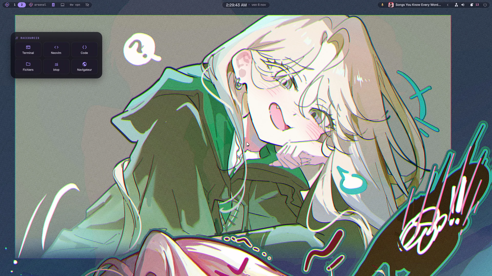
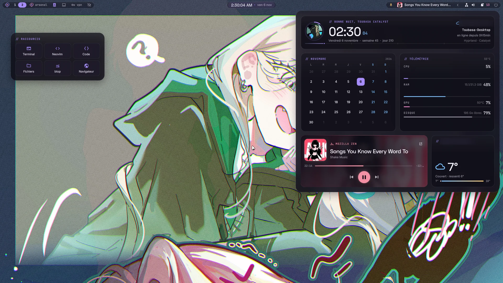
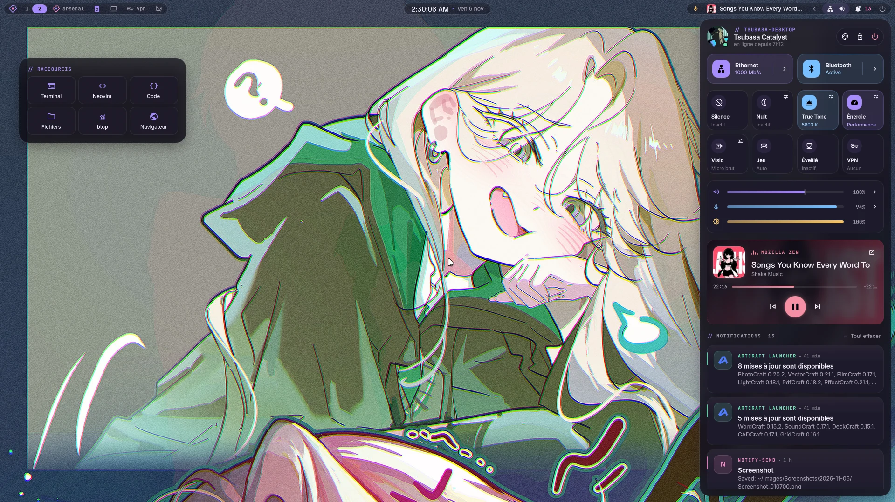
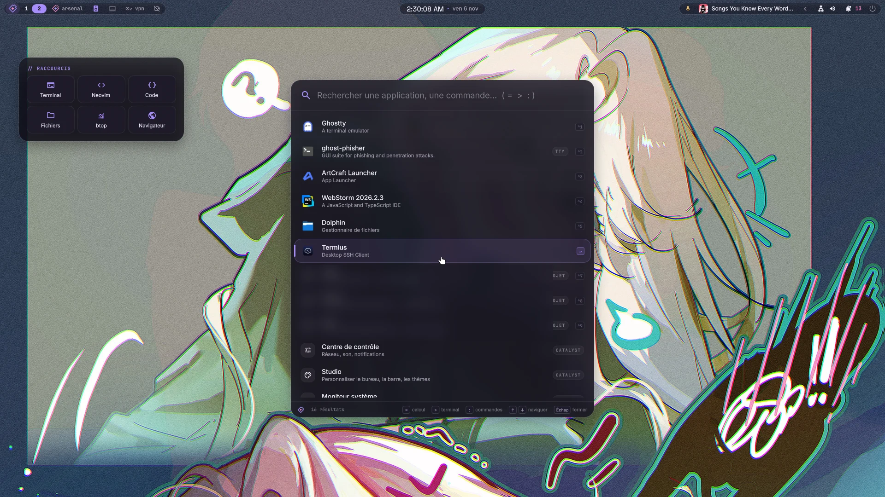
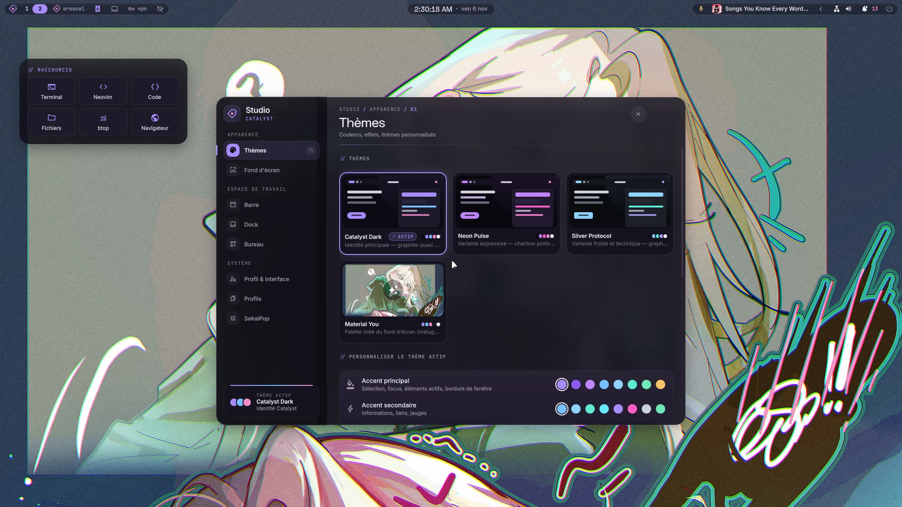
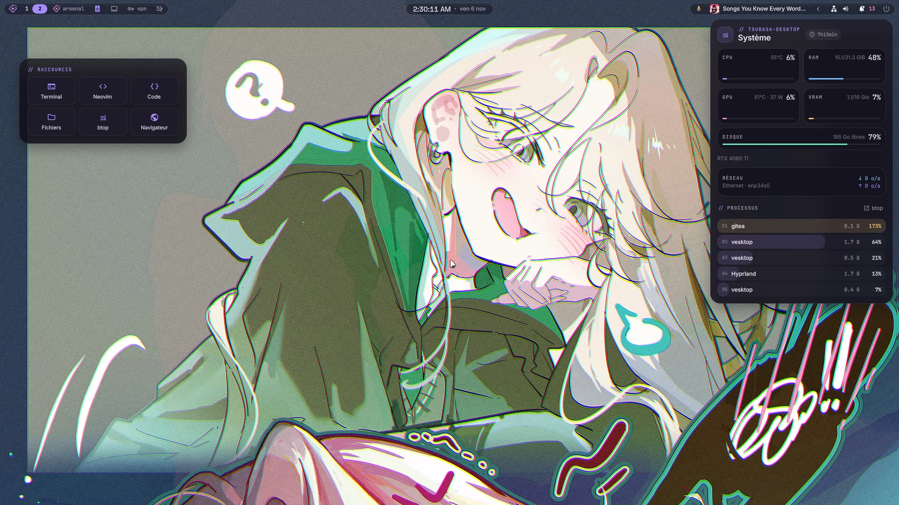
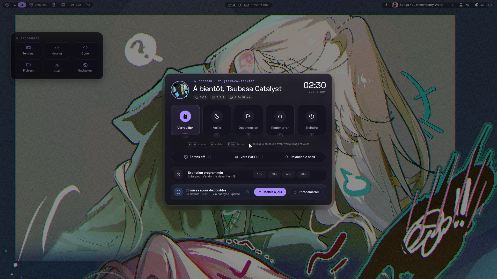
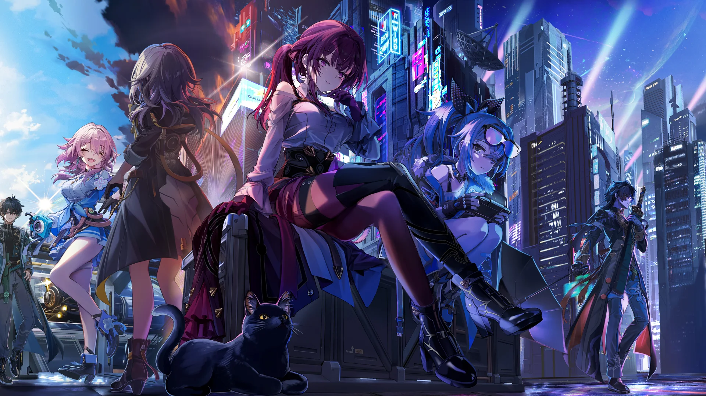
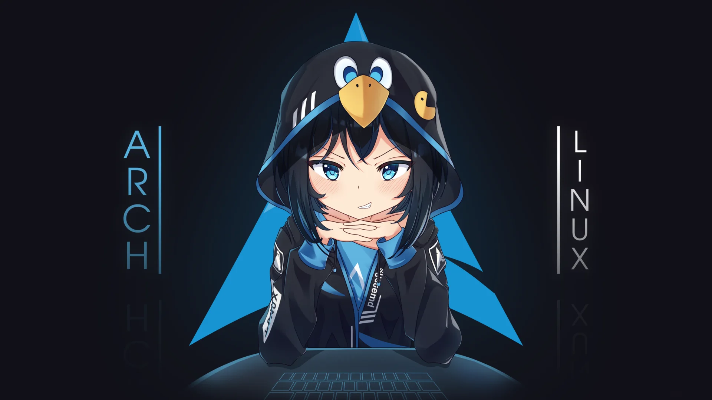
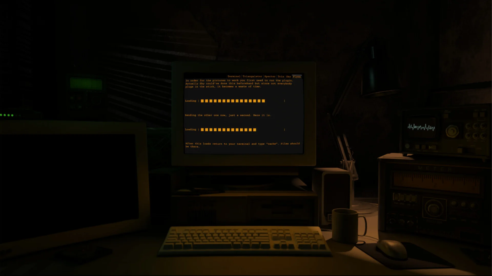

<div align="center">

# ◆ Tsubasa Catalyst

**Rice Hyprland + Quickshell, design cyber-anime, entièrement en français.**

Hyprland 0.57 (config Lua) · Quickshell · thèmes appliqués en direct · CachyOS / Arch



</div>

> Basé sur [lyne-dots](https://github.com/caioax/lyne-dots) de caioax, puis largement réécrit : le shell **Catalyst** (`quickshell/.config/quickshell/catalyst/`) remplace la barre d'origine.

---

## 📸 Aperçu

<table>
  <tr>
    <td width="50%"><br><b>Glance</b> — clic sur l'horloge : heure, calendrier, télémétrie, média, météo</td>
    <td width="50%"><br><b>Centre de contrôle</b> — réseau, Bluetooth, True Tone, énergie, mode visio, VPN, volumes, notifications</td>
  </tr>
  <tr>
    <td><br><b>Launcher</b> — applis, projets, <code>=</code> calcul, <code>&gt;</code> terminal, <code>:</code> commandes Catalyst</td>
    <td><br><b>Studio</b> — thèmes, fonds d'écran, barre, dock, widgets du bureau, profils</td>
  </tr>
  <tr>
    <td><br><b>Moniteur système</b> — CPU, RAM, GPU, disque, réseau, top processus</td>
    <td><br><b>Session</b> — verrouiller, veille, redémarrer, UEFI, extinction programmée, mises à jour</td>
  </tr>
</table>

---

## 🖼️ Fonds d'écran d'exemple

Installés dans `catalyst/wallpapers/sfw/` au premier lancement, à côté de ta propre bibliothèque. Sources dans [CREDITS.md](.data/wallpapers/catalyst/CREDITS.md).

<table>
  <tr>
    <td width="33%"></td>
    <td width="33%"></td>
    <td width="33%"></td>
  </tr>
  <tr>
    <td width="33%"></td>
    <td width="33%"></td>
    <td width="33%"></td>
  </tr>
  <tr>
    <td width="33%"></td>
    <td></td>
    <td></td>
  </tr>
</table>

---

## ✨ Ce qu'il y a dedans

- **Shell Catalyst** (Quickshell/QML) — barre, launcher, centre de contrôle, Studio, glance, calendrier, moniteur système, session, vue d'ensemble, dock, widgets de bureau, OSD et notifications. Tout passe par un design system commun (`kit/`, `rice/Theme`, `Tokens`, `Motion`) avec animations à ressort.
- **Thèmes en direct** — Catalyst Dark, Silver Protocol, Neon Pulse, les palettes classiques (Tokyo Night, Catppuccin, Dracula, Gruvbox, Nord, Rose Pine) et Material You depuis le fond d'écran (matugen). Appliqués sans redémarrage au shell, aux bordures Hyprland, à GTK 3/4, Qt/KDE (Dolphin), rofi et hyprlock.
- **Fonds d'écran** — bibliothèque avec recadrage, fonds animés, et navigateur en ligne (Wallhaven…) intégré au Studio.
- **Outils intégrés** — VPN (WireGuard/OpenVPN, ProtonVPN), machines virtuelles (libvirt), gestionnaire de paquets et dépôts, Arsenal (navigateur d'outils de sécurité BlackArch), scène caméra virtuelle, micro traité + mode visio, presse-papiers, conteneurs Podman/Docker.
- **Hyprland 0.57 en Lua** — config modulaire dans `hyprland/.config/hypr/conf.d/*.lua`, workspaces dynamiques.
- **Terminal** — page dédiée du Studio : bannière (texte, 6 styles, couleur bleue / accent / arc-en-ciel), fastfetch, gadget à l'ouverture (Pokémon précis ou au hasard, shiny, citation, cowsay et ses personnages, bonsaï, au hasard) ; pour Alacritty, Kitty et Ghostty : police, taille, interligne, opacité, marges, curseur, historique, copie à la sélection, couleurs du terminal ou du thème du rice.
- **Profil** — carte façon réseau social (bannière, avatar, pronoms, statut, bio, site, centres d'intérêt, liens GitHub / Discord / X / YouTube / Twitch / Instagram / Bluesky / Reddit / Steam), ouverte en cliquant sur l'avatar du centre de contrôle ; les infos restent hors du dépôt (`~/.config/catalyst/profile.json`).
- **Polices** — police de l'interface, des titres et mono du rice (n'importe quelle police installée, avec aperçu), taille globale du texte, report vers les applis GTK.
- **Le reste** — Neovim (lazy.nvim, LSP), Zsh + Powerlevel10k, Tmux, Kitty, Fastfetch.

La doc détaillée du shell (surfaces, architecture, IPC, thèmes, rollback) est dans [`catalyst/README.md`](quickshell/.config/quickshell/catalyst/README.md).

---

## 📦 Installation

> ⚠️ **C'est ma config perso.** Elle tourne sur CachyOS avec deux écrans 1080p et suppose pas mal d'outils installés (rofi, alacritty, awww, mpvpaper…). Lis la config avant de l'installer.

**Arch et dérivées** (Arch, CachyOS, EndeavourOS, Garuda, BlackArch, Manjaro) :

```bash
git clone https://github.com/mrtsubasa/tsu-dots.git ~/.tsu-dots
cd ~/.tsu-dots
./install.sh --dry-run   # optionnel : voir ce qui sera installé
./install.sh
```

L'installeur détecte la distribution, utilise les dépôts déjà actifs (CachyOS, Chaotic-AUR, BlackArch) et passe par l'AUR pour le reste. Les catégories VM, VPN, caméra et sécurité (dépôt BlackArch) sont optionnelles. `./install.sh --check` vérifie après coup qu'il ne manque rien.

**NixOS** : flake avec modules NixOS + home-manager, **expérimental** → [`nix/README.md`](nix/README.md).

**Autres distributions** : pas de script, la liste des dépendances est dans [.install/README.md](.install/README.md#autres-distributions).

Ta bibliothèque de fonds n'est pas suivie par git (`catalyst/wallpapers/` est ignoré) : l'installeur y copie les fonds d'exemple, ajoute les tiens dans `catalyst/wallpapers/sfw/`.

---

## ⌨️ Raccourcis principaux

| Raccourci | Action |
| --- | --- |
| `Super + Return` / `Super + T` | Terminal |
| `` Super + ` `` | Terminal déroulant |
| `Super + E` | Neovim |
| `Super + Shift + E` | Gestionnaire de fichiers (Dolphin) |
| `Super + D` / `Super + G` | Launcher |
| `Super + Y` | Centre de contrôle |
| `Super + Shift + ,` | Studio |
| `Super + Shift + O` | Vue d'ensemble |
| `Super + X` | Presse-papiers |
| `Super + Shift + S` / `Print` | Capture zone / plein écran |
| `Super + Ctrl + M` | Couper le micro |
| `Super + Alt + V` | Mode visio |
| `Super + Alt + L` | Verrouiller |
| `Super + Alt + R` | Relancer le shell |
| `Super + Q` | Fermer la fenêtre |
| `Super + H J K L` | Focus |
| `Super + Ctrl + H / L` | Déplacer la fenêtre |
| `Super + ← / →` | Workspace précédent / suivant |
| `Super + Alt + ← / →` | Écran gauche / droite |

La liste complète est dans [`keybinds.lua`](hyprland/.config/hypr/conf.d/keybinds.lua), ou dans le launcher avec `:raccourcis`.

---

## 🔧 Tsu CLI

`tsu` gère les dotfiles depuis le terminal (chargé par `.zshrc`).

| Commande | Rôle |
| --- | --- |
| `tsu theme` | thème actuel, `list`, `set <nom>`, `auto` (Material You), `scheme light/dark` |
| `tsu state` | éditer / synchroniser `state.json` |
| `tsu migrate` | migrations (`list`, `run`, `done`) |
| `tsu update` | récupérer les mises à jour et lancer les migrations |
| `tsu git …` | git dans le dossier des dotfiles |
| `tsu reload` | recharger Quickshell |
| `tsu banner [texte]` | afficher la bannière du terminal (ou prévisualiser un autre texte) |

La bannière en lettres blocs affichée à l'ouverture d'un terminal se règle dans **Studio → Profil & interface → Bannière du terminal**.

> `tsu update` fait un `git reset --hard` avant de mettre à jour : commite tes modifications avant.

---

## 📁 Structure

Chaque dossier à la racine est un paquet Stow lié dans `$HOME`.

| Dossier | Contenu |
| --- | --- |
| `quickshell/` | shell Catalyst (`catalyst/`) + scripts Python/Bash |
| `hyprland/` | Hyprland (Lua), hypridle, hyprlock, UWSM |
| `nvim/` | Neovim |
| `zsh/`, `tmux/`, `kitty/`, `alacritty/`, `ghostty/`, `fastfetch/` | terminal |
| `theming/`, `kde/` | GTK 3/4, Qt5/6, kdeglobals |
| `local/` | scripts perso, binaire `tsu` |
| `niri/` | scripts appelés par les raccourcis (`~/.config/niri/scripts/` : menus rofi, fonds d'écran, captures, audio…) |
| `.install/` | scripts d'installation et listes de paquets |
| `nix/`, `flake.nix` | support NixOS / home-manager (expérimental) |
| `.data/` | thèmes, templates matugen, tsu-cli, fonds par défaut |

Les clés d'API (ex. Gelbooru) vont dans `~/.config/catalyst/secrets.env`, jamais dans le dépôt.

Les réglages propres à la machine (écrans, autostart, variables, raccourcis locaux) vont dans `~/.config/hypr/local/` et ne sont pas suivis par git.

---

## 🙏 Crédits

- [lyne-dots](https://github.com/caioax/lyne-dots) par caioax — la base de départ
- [HyprQuickFrame](https://github.com/Ronin-CK/HyprQuickFrame) — inspiration de l'outil de capture
- [caelestia](https://github.com/caelestia-dots/shell) — inspiration des animations et widgets

Licence [GPL-3.0](LICENSE).
