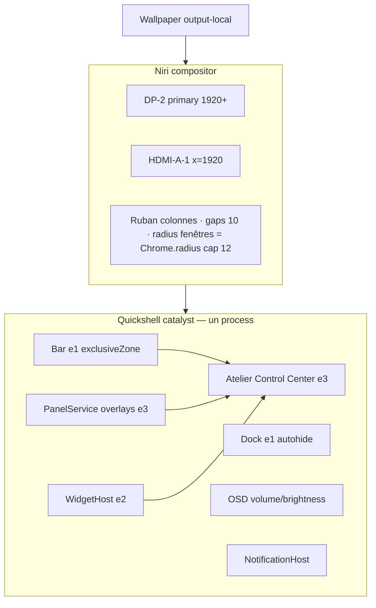
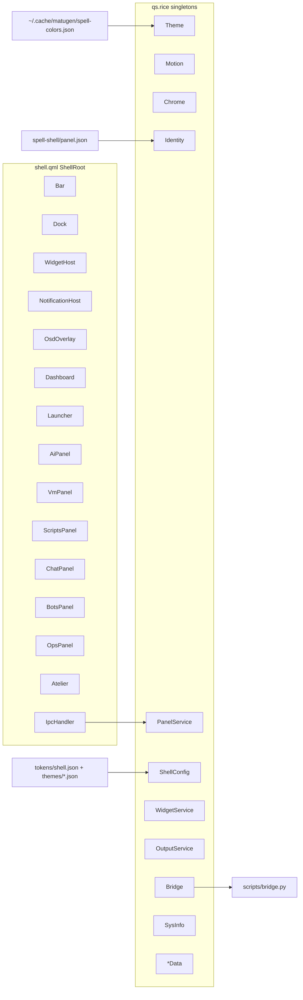
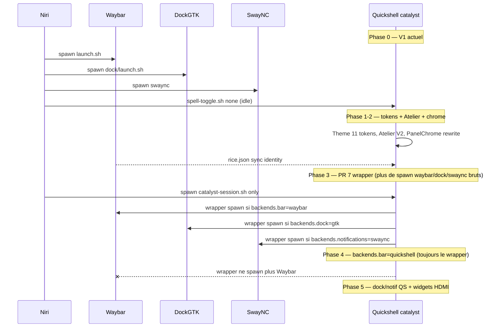

# Catalyst V2 — Identité visuelle et architecture shell (Quickshell / Niri)

| Champ | Valeur |
|---|---|
| Titre | Catalyst V2 — Design System & Architecture Shell |
| Auteur | Senior Product Designer / Systems Architect |
| Date | 2026-09-14 |
| Statut | Draft (rév. 4) |
| Cible | Daily driver Linux, compositor **Niri**, shell **Quickshell 0.3.1** |
| Workspace | `/home/tsu/.config` |
| Nom de produit | **Catalyst** |
| Nom du Control Center | **Atelier** |

---

## Overview

Catalyst V1 est déjà un rice sérieux : Niri en ruban, Waybar multi-styles, dock GTK4, swaync, et un processus Quickshell (`~/.config/quickshell/catalyst`) qui porte les overlays uniques (Dashboard, Launcher, IA, VM, Scripts, Comms, Bots, Ops).

**Source visuelle ≠ Atelier V1.** Le chrome wallpaper full-bleed + voile 0.78 + hairline + air vit sur le **Dashboard** (`PanelChrome.qml` crop + `Rectangle` veil). L’Atelier V1 est un **sidecar 6 chips** : `Rectangle` 320×dash.height, `surfaceContainer @ 0.92`, **sans** wallpaper ni grain (`Dashboard.qml` L238–266, `Chip` 28 / radius 8 / gap 8). La capture de référence (header `ATELIER` tracking-wide, X circulaire, voile, pills full-width gap 16–20) est la **cible V2**, pas l’état du sidecar. V2 **promouvoit** les 6 chips dans le chrome Dashboard : même voile, même filet, Control Center complet.

Un seul processus Quickshell devient le shell of record (barre, dock, notifications, OSD, widgets, Atelier, overlays). Les identités (Wolf, Îlots, Lain, Tsubasa, plus Brume, Signal, Eclipse) ne sont plus des skins Waybar : ce sont des *personnalités* (géométrie, motion, densité, chrome) branchées sur un design system unique. Rien n’est copié depuis Caelestia, macOS, Linear ou Discord — on conserve le mystère cyber-minimal déjà présent, on le rend cohérent, pixel-précis, et daily-driver.

---

## Background & Motivation

### État actuel (V1)

Le desktop est un **assemblage de quatre familles de process** :

| Couche | Process | Fichiers |
|---|---|---|
| Compositor | niri | `~/.config/niri/config.kdl` (sorties `DP-2` + `HDMI-A-1`, gaps 10, radius fenêtres 12) |
| Barre | waybar × N outputs | `~/.config/waybar/styles/{silverwolf,islands,lain,tsubasa,apple,initiald,custom}/` assemblé par `assemble.py` + `rice.json` |
| Dock | GTK4 layer-shell | `~/.config/dock/dock.py` + `dock.json` (icône 32, gap 10, position `right`, theme `lain`). `rice.json` `"dock": false` **ne gâte pas** le spawn : `config.kdl` L107 lance toujours `dock/launch.sh` |
| Notifications | swaync | `~/.config/swaync/config.json` (380×720, titre `SYS.NOTIF`) |
| Overlays | quickshell catalyst | `~/.config/quickshell/catalyst/shell.qml` — IPC `qs ipc -p ~/.config/quickshell/catalyst call panels open <name> <output>` |

Palette : **matugen** écrit `~/.cache/matugen/spell-colors.json` (Material You `scheme-content`) ; `rice/Theme.qml` le charge via `FileView`. Identité panneau : `~/.config/spell-shell/panel.json`. Style barre : `~/.config/waybar/rice.json` (`"style": "islands"` aujourd’hui).

Overlays déjà first-class, namespace `catalyst-panel` :

- `modules/dashboard/Dashboard.qml` — bento 920×560 drop-from-top, chrome `PanelChrome` (voile + wallpaper). Atelier = sidecar 6 chips opaque, pas le voile.
- `modules/launcher/Launcher.qml` — 640×520 rise-from-bottom, `SYS.APPS`
- `modules/ai/AiPanel.qml`, `vm/VmPanel.qml`, `scripts/ScriptsPanel.qml`, `chat/ChatPanel.qml`, `bots/BotsPanel.qml`, `ops/OpsPanel.qml` — tous via `components/SideShell.qml`

Binds Niri (`config.kdl`) : `Mod+Y` dashboard, `Mod+D`/`Mod+G` launcher, `Mod+N` ai, `Mod+B` vm, `Mod+S` scripts, `Mod+Shift+T` chat, `Mod+Shift+B` bots, `Mod+Shift+O` ops. `Mod+Comma` = `consume-window-into-column` (L389) ; `Mod+A` = Claude panel (L253) — **ne pas les voler**. Startup : `spell-toggle.sh none` lance le process qs en idle. IPC live : `open` (`spell-toggle.sh`) **et** `show` (`menus.sh` L11).

### Douleur

1. **L’identité Atelier n’irrigue pas la barre, le dock, ni les notifs.** Waybar `silverwolf` est un HUD cyan/magenta 28 px ; `lain` est un CRT vert 26 px ; `tsubasa` un bandeau bleu/or 34 px ; `islands` est le plus proche de l’Atelier mais reste du CSS Waybar, pas du même chrome QML (`PanelChrome.qml` a déjà trop de glow, filet 2 px, CornerMark aux 4 coins, bandeau dégradé).
2. **Atelier n’est pas un Control Center.** Sidecar opaque 6 `Chip` (28 / radius 8 / gap 8), close `IconBtn` 34×34 radius 10. Loin de la capture cible (pills full-width, gap 16–20, radius 12–16, X circulaire, wallpaper voilé — chrome qui existe déjà sur le **Dashboard**).
3. **Quatre process, quatre langages visuels.** Waybar + GTK dock + swaync + Quickshell ne partagent que des hex matugen, pas la géométrie, pas le motion, pas la typo.
4. **Tokens Material You trop denses.** `Theme.qml` expose 25+ couleurs `surfaceContainer*` héritées de matugen. L’Atelier n’en utilise qu’une poignée. V2 réduit à une palette nominale de 11 tokens (voir §9) + overlays matugen optionnels.
5. **Modules uniques sous-exposés.** IA / VM / Scripts / Comms / Bots / Ops existent, Caelestia ne les a pas, mais ils sont relégués à des `QuickBtn` 64 px et des `SideShell` coins. V2 les traite comme des applications du shell, pas des gadgets.
6. **Un second arbre Quickshell** (`~/.config/quickshell/modules/bar`, `services/`, etc.) existe à côté de catalyst. Il n’est pas le rice. V2 **n’y touche pas** : tout vit sous `catalyst/`.

### Ce qu’il ne faut pas casser

- Latence d’ouverture overlay **cible** : **≤ 30 ms p95** process chaud (`qs ipc call panels open` / `show`). `spell-toggle.sh` **ne mesure pas** aujourd’hui ; le chemin froid est `qs -p … -n -d` + `sleep 0.2` (≈ 250 ms). Budget = garder le process chaud au spawn, pas une magie IPC.
- Identités Wolf / Îlots / Lain / Tsubasa (noms UI, pas IDs internes `silverwolf` / `islands`).
- Modules IA, VM, Scripts, Comms, Bots, Ops.
- Wallpaper → matugen → recolor, déjà filé jusqu’à GTK/Rofi/swaync.
- Dual-monitor Niri `DP-2` (primary, `focus-at-startup`) + `HDMI-A-1` (`x=1920`).

---

## Goals & Non-Goals

### Goals

- Un **langage visuel OS-level** dérivé du chrome Dashboard (`PanelChrome` voile / filet / air / mono tracking-wide), pas d’un kit Material. L’Atelier V2 **hérite** ce chrome ; il ne « préserve » pas un voile que le sidecar V1 n’a pas.
- **Un process Quickshell** comme shell of record, avec flags de coexistence Waybar / dock GTK / swaync pendant le rollout.
- Atelier V2 = Control Center (identité, wallpaper, barre, dock, widgets, motion, transparence, blur, accent, densité).
- Identités = personnalités complètes (palette + radius + blur + bar layout + motion + chrome), pas des palettes.
- Widgets desktop modulaires, **off par défaut**, **HDMI-A-1 only** en V2, masqués dès qu’une fenêtre mapped existe sur cet output.
- Architecture QML 1:1 sous `~/.config/quickshell/catalyst`.
- Daily-driver après quelques heures : lisible, contrasté, clavier-first, perf bornée.
- 2–3 identités nouvelles **de la même famille**.

### Non-Goals

- Porter Catalyst sur Hyprland (Niri only). Le second arbre `~/.config/quickshell/` n’est pas fusionné.
- Installer Caelestia, DankMaterialShell, AGS, EWW.
- HUD cyberpunk, néon saturé, scanlines partout, glitch permanent.
- UI « AI-generated » (gradients rainbow, glass iOS 18, gros pictos filled, coins 999 px).
- Remplacer Niri (overview, workspaces, gaps) par un shell qui les redessine.
- Light mode / Brume-day (identités nocturnes uniquement. V3 éventuel).
- Refonte fonctionnelle d’IA/VM/Scripts/Comms/Bots/Ops — V2 les *habille* et les hiérarchise, ne réécrit pas `bridge.py`.
- Implémenter du QML dans ce document (spec only).

---

## Proposed Design

### 1. Concept global / nom de produit

**Catalyst** reste le nom du produit. Justification, pas nostalgie :

- Déjà gravé dans le rice : `panel.json` `"os_label": "Catalyst"` exposé QML comme `Identity.osText` (via `bridge.py identity()`, pas une property `os_label`), `"display_name": "Tsubasa Catalyst"`, namespace `catalyst-panel`, path `quickshell/catalyst`, binds commentés `WIDGETS CATALYST`.
- Métaphore exacte : le wallpaper est le **réactif**, matugen la **réaction**, l’identité le **catalyseur** qui change la forme sans être consommé. Wolf ne « peint » pas le desktop, il accélère une certaine géométrie.
- Ce n’est ni un nom de distro générique (Aether, Nexus, Zenith), ni un nom d’anime, ni un clone Caelestia/Hypr.
- Prononçable en français, file dans un header mono : `CATALYST` à 11 px / tracking 0.22 em.

**Atelier** est le Control Center — l’atelier où l’on choisit le catalyseur. Ce n’est pas le nom de l’OS. Sur Dribbble, la pièce héroïque s’appelle *Atelier / Catalyst Desktop*. Sur GitHub, le repo / le path restent `catalyst`.

Signature verbale, toujours en small-caps mono :

```
CATALYST
atelier · niri · dp-2
```

Marque unique : un **point 4×4 px** (pas un logo dessiné) en `accent`, collé à gauche des workspaces. **Brume n’a pas de mark** (wallpaper first — clock seul au centre, workspaces à gauche sans logo). Présence par identité :

| Identité | Mark |
|---|---|
| Îlots | point 4×4 `accent` |
| Wolf | `SW` 10 px tracking 2.4 px |
| Lain | `LN` |
| Tsubasa | `TS` |
| Signal | `∿` (U+223F, 11 px) |
| Eclipse | `●` creux (filet 1 px) |
| Brume | **aucun** |

C’est le seul « logo ». Pas de wordmark `CATALYST` dans la barre.

---

### 2. Design system

Le système est **un chrome**, pas une peau. Toutes les surfaces (barre, dock, Atelier, overlays, widgets, toasts) descendent de cinq axes.

#### 2.1 Axes

| Axe | Rôle | Bornes |
|---|---|---|
| **Air** | Negative space | Densité `air` (défaut) / `regular` / `compact` |
| **Hairline** | Bord 1 px, jamais 2 sauf Wolf/Lain chrome barre | `border.hairline = 1` |
| **Veil** | Wallpaper visible, pas frost-to-death | Opacity fill 0.42–0.78 ; blur 0–24 |
| **Mono chrome** | Headers, clock, stats, ATELIER | JetBrainsMono NF, tracking large, uppercase |
| **Motion court** | 150–300 ms, OutCubic | Appear = translate 8–16 px + fade |

#### 2.2 Spacing scale (`space`)

Unité 4 px. Rien en dehors de cette échelle.

| Token | px | Usage |
|---|---|---|
| `space.0` | 0 | — |
| `space.1` | 4 | gap icônes barre, indicateur dock |
| `space.2` | 8 | padding interne îlot, gap modules barre |
| `space.3` | 12 | margin îlots / dock / overlay side |
| `space.4` | 16 | gap pills Atelier, gap widgets, margin overlay |
| `space.5` | 20 | padding horizontal Atelier |
| `space.6` | 24 | gap de sections Atelier, origin widgets Y sous barre |
| `space.8` | 32 | — |
| `space.10` | 40 | offset appear horizontal |
| `space.12` | 48 | offsets overlay / Atelier height floor — **pas** l’exclusive zone barre |

Exclusive zone barre (Niri `exclusiveZone`) = **`marginTop + bar.h` uniquement**. L’air sous la barre (8 px Îlots) n’est **pas** exclusive — les fenêtres peuvent y coller. Îlots air : 8+28 = **36** (Waybar islands aujourd’hui : height 28 + margin-top 8 ≈ 36). Wolf/Lain flush : 0+28/26 = 28/26.

Densité : paddings / gaps suivent la scale `air` telle quelle ; `regular` ×0.85 arrondi au multiple de 4 ; `compact` ×0.7 arrondi (gap pills 12). **Hauteur de barre : pas cette multiplication** — voir §2.7 (base identité + delta).

#### 2.3 Radius scale (`radius`)

| Token | Wolf | Îlots | Lain | Tsubasa | Brume | Signal | Eclipse |
|---|---|---|---|---|---|---|---|
| `radius.none` | 0 | 0 | 0 | 0 | 0 | 0 | 0 |
| `radius.sm` | 4 | 8 | 0 | 6 | 10 | 4 | 6 |
| `radius.md` | 6 | 12 | 0 | 10 | 14 | 6 | 10 |
| `radius.lg` | 6 | 16 | 0 | 14 | 18 | 8 | 12 |
| `radius.pill` | 6 | 14 | 0 | 14 | 16 | 8 | 12 |
| `radius.full` | 999 | 999 | 0 | 999 | 999 | 999 | 999 |

Lain : **zéro radius partout**, y compris le close (carré, `x` mono 12 px — pas un cercle). Wolf : radius petit (6), jamais pastille iOS. Îlots : 16, c’est le look de la capture. `radius.full` uniquement pour le bouton close **circulaire** (toutes identités sauf Lain) et l’avatar.

Aujourd’hui `Chrome.qml` code ça en `if (st === ...)` — V2 lit les tokens JSON (voir Data Model).

#### 2.4 Elevation & blur

Pas d’ombres portées **colorées** (V1 `PanelChrome` drop-shadow `Theme.primary` 45 % : **supprimé**, trop néon). `MultiEffect` reste **uniquement** pour une ombre noire (pas pour le backdrop).

Deux mécanismes, ne pas les confondre :

| Mécanisme | Où | Comment | Interdit |
|---|---|---|---|
| **Veil** (Atelier / Dashboard) | crop wallpaper + `Rectangle` `#000` @ veil | déjà V1 `PanelChrome.qml` L22–35 | `FastBlur` / `MultiEffect.blur` sur le wallpaper |
| **Backdrop blur** (barre, dock, overlays e1+) | compositor | niri `layer-rule { match namespace=… ; background-effect { blur true } }` **uniquement si niri ≥ 26.04** (`Window Effects` / `ext-background-effect`). **Include** KDL = niri ≥ **25.11** (séparé). | `MultiEffect.blur` ; écrire `background-effect` sur niri &lt; 26.04 (parse fail, reload refusé — le fallback veil ne tourne jamais) |
| **Drop-shadow** | PanelChrome e2+ | `MultiEffect { shadowEnabled: true ; shadowColor: rgba(0,0,0,.40) }` | shadow teintée `Theme.primary` |

`chrome.blurBackdrop` **on seulement Îlots et Brume**. Off Wolf / Lain / Tsubasa / Signal / **Eclipse** (filet only, mystère, budget GPU). `catalyst-session.sh` parse `niri --version` :

- ≥ 26.04 **et** `blurBackdrop` → écrit le nœud `background-effect { blur true }`
- &lt; 26.04 ou `blurBackdrop: false` → **omet le nœud** (KDL toujours valide) + **veil +0.08** sur la surface. Jamais de nœud inconnu « en espérant que niri l’ignore ».

| Niveau | Fill (QML) | Backdrop | Ombre | Usage |
|---|---|---|---|---|
| `e0` | transparent | none | none | wallpaper, widgets off |
| `e1` | `surfaceV2` @ **`bar.opacity` (0.82)** barre ; `surfaceV2` @ **0.55** dock pill. Jusqu’au sweep : **`Theme.surfaceContainer`**, **jamais `Theme.surface`** (PR 1 laisse `surface` = background `#101417`) | niri blur si flag **et** ≥ 26.04 | none | îlots barre vs dock. Source of truth barre = `shell.json bar.opacity` (= Waybar islands `alpha(@surface_container, 0.82)`). Dock 0.55 volontaire. |
| `e2` | `surfaceV2` / `Theme.surfaceContainer` @ 0.72 | idem | 0 8 28 rgba(0,0,0,.35) via MultiEffect | widgets, SideShell |
| `e3` | `surfaceV2` / `Theme.surfaceContainer` @ 0.78 | idem | 0 12 40 rgba(0,0,0,.40) | Atelier, Dashboard, Launcher |
| `e4` | `surfaceV2` / `Theme.surfaceContainer` @ 0.88 | none | 0 16 48 rgba(0,0,0,.45) | menus, combo, OSD |

**Règle PR 1–sweep :** tout chrome neuf (barre, dock, widgets, Atelier) bind `Theme.surfaceContainer` ou `Theme.surfaceV2`. Bind `Theme.surface` = régression (fill trop sombre, plus l’équivalent islands 0.82).

Budget : **au plus une** surface backdrop-blurred visible (barre **ou** overlay, pas les deux empilés à full strength — overlays e3 peuvent garder le blur niri, la barre reste). Pas de blur QS empilé.

#### 2.5 Hairline

Toute surface `e1+` a :

1. Bord externe 1 px `border` @ 0.55–0.70 (identité).
2. Highlight interne 1 px `#ffffff` @ 0.10–0.14, inset 1 px, **uniquement le bord haut** (déjà dans `PanelChrome.qml` L80–87 — on garde, on retire le filet gauche 2 px et le gradient top 2 px).

Wolf a le droit à un filet **haut** cyan 1 px + filet **bas** magenta 1 px **sur la barre seulement**. Ailleurs, un seul hairline.

#### 2.6 Motion tokens (`motion`)

Voir §11. Valeurs par défaut :

```
motion.fast      150 ms   hover, color, border
motion.base      220 ms   appear overlay, dock lift
motion.slow      280 ms   dashboard / launcher / atelier
motion.theme     400 ms   crossfade identité
easing.out       OutCubic
easing.inOut     InOutCubic
easing.spring    OutBack overshoot 1.06  (dock hover only, amplitude 6 px)
appear.dy        12 px    (top surfaces −12, bottom +12)
appear.dx        16 px    (Atelier depuis la droite)
appear.fade      0 → 1
```

`SideShell.qml` V1 : duration **120 ms** + scale 0.96 — trop nerveux, trop « pop UI ». V2 : 220 ms, **pas de scale** (le scale 4 % sent le mobile). Translate + fade only.

#### 2.7 Densité

Paddings / pills / dock icon suivent la table. **Hauteur de barre = base identité + delta densité**, clamp ≥ 24.

| Densité | Δ bar.h | pill.h | dock.icon | overlay.margin | font.ui |
|---|---|---|---|---|---|
| `air` | 0 | 44 | 36 | 16 | 13 |
| `regular` | −2 | 40 | 32 | 12 | 12 |
| `compact` | −4 | 36 | 28 | 8 | 12 |

Bases `themes/<id>.json bar.height` (air) : Îlots 28, Brume 28, Wolf 28, Lain 26, Tsubasa 32, Signal 26, Eclipse 28. `panel.json` a déjà `"density": "air"` et `"bar_height": 28`.

Exemples :

| Identité | air | regular | compact |
|---|---|---|---|
| Îlots | 28 | 26 | 24 |
| Lain | 26 | 24 | **24** (clamp) |
| Tsubasa | 32 | 30 | 28 |
| Signal | 26 | 24 | **24** (clamp) |

`exclusiveZone = marginTop + bar.h` après delta. Tsubasa air : 6+32 = 38 ; compact : 6+28 = 34 (marginTop identité inchangé).

---

### 3. Layout desktop complet (Niri + overlays + barre + dock + widgets)



#### Empilement Z (WlrLayer)

| Z | Layer | Namespace | Exclusive |
|---|---|---|---|
| 0 | wallpaper (swww / niri bg) | — | — |
| 1 | widgets | `catalyst-widget` | 0 |
| 2 | bar | `catalyst-bar` | `marginTop + bar.h` (Îlots air = 36 ; pas le 8 px d’air sous les îlots) |
| 3 | dock | `catalyst-dock` | 0 si autohide, sinon dock thickness + 8 |
| 4 | notifications toasts | `catalyst-notif` | 0 |
| 5 | overlays + Atelier + OSD | `catalyst-panel` | 0, `ExclusionMode.Ignore` |

On **conserve** le namespace `catalyst-panel` pour les overlays (layer-rule Niri déjà en place L172–175). Barre et dock prennent des namespaces dédiés pour des layer-rules distinctes (`background-effect` / corner).

#### Ruban Niri — snippet généré + **une** édition one-shot de `config.kdl` (PR 5)

`config.kdl` est hand-edited : `layout {}` L38–96 (`gaps 10`, `focus-ring { width 3; active-gradient from="#89dceb" to="#cba6f7" angle=45 }`, `tab-indicator active-color "#cba6f7"`), `window-rule { geometry-corner-radius 12 }` L148–151. **Pas d’include aujourd’hui.** QML ne réécrit jamais le fichier principal.

Niri `include` (depuis **25.11**) : top-level only, **merge**. Les clés plus tardives gagnent ; **les clés nested non mentionnées sont conservées**. Conséquence : un snippet `focus-ring { width 2; active-color <accent> }` **laisse `active-gradient` en place** si le bloc main n’a pas été nettoyé. Un `include` **au-dessus** de `layout {}` est un no-op (le bloc hand-edited gagne). Un include dont le fichier **manque** fait échouer `niri validate` / reload — ce n’est **pas** « gaps 10, pas de crash ».

**Ordre PR 5 (strict) :**

1. **Générer d’abord** `~/.config/niri/catalyst-theme.kdl` **toujours valide** (identité courante, défaut Îlots). Ne **jamais** ajouter l’include avant que ce fichier existe.
2. Édition **one-shot** de `config.kdl` :
   - Dans le `focus-ring` **principal** : **commenter ou supprimer `active-gradient`** (garder `inactive-color` si voulu). Le merge **ne peut pas** dropper un gradient.
   - **Append** en **toute fin de fichier** : `include "catalyst-theme.kdl"` (après `layout {}` et les `window-rule`).
3. Reload : `niri msg action load-config-file` (+ `do-screen-transition` si dispo). File-watch live-reload niri ne sauve pas un parse error.

Snippet **complet** (exemple Îlots, niri ≥ 26.04, `blurBackdrop` on) — toutes les clés qu’on veut vraiment gagner :

```kdl
// ~/.config/niri/catalyst-theme.kdl — généré, ne pas éditer à la main
layout {
    gaps 12
    focus-ring {
        width 2
        active-color "#a5dbff"
        // pas de active-gradient ici ; le main file ne doit plus en avoir
    }
    tab-indicator {
        active-color "#a5dbff"
    }
}
window-rule {
    geometry-corner-radius 12
}
layer-rule {
    match namespace="catalyst-bar"
    background-effect { blur true }
}
layer-rule {
    match namespace="catalyst-dock"
    background-effect { blur true }
}
layer-rule {
    match namespace="catalyst-panel"
    background-effect { blur true }
}
```

Niri **&lt; 26.04** : **omettre entièrement** les trois `layer-rule { background-effect … }` (include 25.11 reste OK). `blurBackdrop` false (Wolf/Lain/Tsubasa/Signal/Eclipse) : même omission. Nœuds inconnus = **jamais écrits**.

Scope snippet : gaps, focus-ring solid `active-color`, window radius (`min(12, Chrome.radius.lg)`, Lain 0), tab-indicator, blur layer-rules si gate. Hors scope : shadows fenêtres, preset column widths, animations Niri.

#### Carte d’un output (DP-2, 1080p type)

```
y=0
┌──────────────────────────────────────────────────────────────────────────┐
│  8px marginTop (exclusive)                                               │
│  ┌─ island left ─┐      ┌─ clock ─┐      ┌──────── island right ───────┐ │  bar 28
│  └───────────────┘      └─────────┘      └─────────────────────────────┘ │
│  8px air visuel, NON exclusive                                           │
│                                                                          │
│   Widgets : pas sur DP-2. HDMI-A-1 only, hide si fenêtre mapped.         │
│                                                                          │
│                         NIRI RIBBON  (windows)                           │
│                                                                          │
│                                          Atelier 400×min(720, H-48)      │
│                                          collé right=16, top=40          │
│                                                                          │
│              ┌──────────── dock pill ────────────┐                       │
│              └───────────────────────────────────┘  margin-bottom 8      │
└──────────────────────────────────────────────────────────────────────────┘
```

HDMI-A-1 : même barre (style identique, workspaces **locaux** `all-outputs: false` comme V1), dock **off par défaut** (primary only, `dock.json` `"monitors": "primary"` aujourd’hui). **Widgets : HDMI-A-1 only**, off par défaut, **cachés** dès qu’une fenêtre mapped existe sur cet output (le ruban Niri gagne). DP-2 n’héberge pas de widgets en V2 (daily-driver tiling). Placement persisté `{output, x, y}` pour une éventuelle V3 multi-output ; le host V2 ignore tout `output != HDMI-A-1`.

---

### 4. Top bar

La barre est le chrome le plus vu. Elle doit être **ennuyeuse-élégante**. Pas de CPU en clair en permanence. Pas de titre de fenêtre de 36 caractères. Pas d’icônes géantes.

#### 4.1 Géométrie par identité

| Identité | Mode | H | Margins | Layout |
|---|---|---|---|---|
| **Îlots** (défaut V2) | 3 islands | 28 | top 8, x 12 | left / center / right |
| **Brume** | 3 islands, plus d’air | 28 | top 10, x 16 | left / center / right, gap 12 |
| **Wolf** | continuous | 28 | 0 | full-bleed, filet haut cyan + bas magenta |
| **Lain** | continuous | 26 | 0 | full-bleed, filet bas 1 px vert |
| **Tsubasa** | continuous rounded | 32 | top 6, x 14, radius 14 | clock center, athletic |
| **Signal** | continuous | 26 | 0 | filet bas amber 1 px, modules plus aérés |
| **Eclipse** | continuous | 28 | 0 | presque noir, filet haut violet 1 px |

Legacy `apple` (H 32, Inter, workspaces center) et `initiald` (bandeau rouge) : **non exposés** dans Atelier. Restent chargeables via `shell.json` `legacyIdentities: true`.

#### 4.2 Modules — ordre canonique (Îlots / Brume)

**Island left** (hug contents, max 42 % width) :

```
[ pad 8 ][ mark 20 ][ 8 ][ workspaces ][ 8 ][ window? ][ pad 8 ]
```

- `mark` : voir table §1. **Îlots / Eclipse** : point 4×4. **Brume : pas de mark** (island-left commence aux workspaces). Wolf `SW` (cette personnalité seulement). Lain `LN`. Tsubasa `TS`. Signal `∿`.
- Clic mark — polarité **Îlots** (canonique V2, = Waybar `islands/config.jsonc` L84–87) : **clic gauche → Dashboard**, **clic droit → Launcher**. Wolf (mark `SW`) peut garder la polarité silverwolf (gauche launcher / droit dashboard) comme override d’identité `bar.markClick: "wolf"` ; défaut `bar.markClick: "ilots"`.
- Workspaces : index Niri, **chiffres mono 11 px**, bouton 22×18, gap 2. Actif = `text` (Îlots) ou fill `accent` (Wolf). Urgent = `danger`, pas d’animation bounce.
- Window title : **off par défaut en V2** (le ruban Niri montre déjà la fenêtre). Flag `bar.windowTitle: false`. Si on, max 28 chars, `text-muted`, rewrite vide → rien (pas `localhost` / `hack://` — trop HUD).

**Island center** (hug) :

```
[ pad 16 ][ clock ][ pad 16 ]
```

- Clock : `HH:MM` 13 px / weight 700 / tracking 0.6 px / `text`. Pas de secondes par défaut. `panel.json` `"clock_sec": true` pilote **Dashboard / SysInfo**, pas la barre Îlots (déjà `HH:MM`). Les secondes barre Wolf `T+{%H:%M:%S}` sont un override d’identité (`bar.clockSeconds: true` dans `wolf.json`), pas le flag panel global.
- Clic → **popover calendrier attaché à la barre** (`modules/bar/modules/CalendarPopover.qml`, ancré sous l’island center). **Pas** le widget desktop HDMI. Clic droit → copie `YYYY-MM-DD HH:MM:SS`.
- Format 24 h défaut. `clock12` reste dans Atelier.

**Island right** (hug, pack right) :

```
[ sys collapsed ][ 8 ][ net ][ 6 ][ vol ][ 6 ][ notif ][ 6 ][ batt? ][ pad 8 ]
```

| Module | Idle | Hover / clic | Jamais |
|---|---|---|---|
| `sys` | une lettre `S` ou rien — **glyph unique 11 px** `󰻠` si un meter > 80 %, sinon **caché** | hover 400 ms → drawer CPU/RAM/GPU 3 s refresh | pourcentages en clair en permanence (V1 waybar `cpu.{usage}` est trop HUD) |
| `net` | icône 14 px, `text-muted` ; `danger` si down | clic → **popover réseau barre** (`NetworkPopover.qml`) ; fallback `nmtui`. **Pas** `WidgetHost` HDMI | SSID en clair |
| `vol` | icône 14 px | scroll = volume ; clic = OSD + mixer | pourcentage |
| `notif` | cloche 14 px ; dot `danger` 4 px si unread | clic = NotificationCenter | count numérique (bruyant) |
| `batt` | **absent** sur desktop sans batterie (UPower probe une fois, service **réimplémenté** dans `catalyst/rice/BatteryService.qml`, pas d’import de l’arbre voisin) | — | icône fantôme |
| tray | **pas dans la barre**. Chevron `󰍜` ouvre `TrayPopover` (remplace `tray-box.py`) | — | 12 icônes StatusNotifier |

VPN / target HTB (`waybar/scripts/vpn.sh`, `target.sh`) : **sortent de la barre**. Ils vivent dans le module **Ops** et, en option, le widget Ops. Les coller dans la barre casse la promesse « extremely clean ».

Group `tools` Waybar (icônes IA/VM/Scripts/…) : **sort de la barre**. Ces modules s’ouvrent au clavier et depuis le Dashboard. Un dock d’outils dans la barre est un HUD.

#### 4.3 Mockup textuel — Îlots, DP-2 1920×1080, densité air

```
y=0..7     (8 px marginTop — INCLUS dans exclusiveZone)
y=8..35    bar content 28 px
exclusiveZone = 8+28 = 36
y=36..43   8 px air visuel sous îlots, NON exclusive

x=12                                                    x=1908
┌──────────────────────────────┐   ┌──────────┐   ┌─────────────────────┐
│  ·  1  2  3  4               │   │  21:14   │   │              󰤨  󰕾  󰂚 │
└──────────────────────────────┘   └──────────┘   └─────────────────────┘
   island-left ~ 280 px              center 108      island-right ~ 148
   radius 16                         radius 16        radius 16
   fill surfaceV2@0.82 (Theme.surfaceContainer, pas Theme.surface)
   border 1px outlineVariant

Island left inner:
  x+8  mark 4×4 at cy
  x+20 workspaces: each hit 22×18, digit centered, active color=text (not fill)
  no window title

Island center inner:
  clock "21:14"  JetBrainsMono 13/700  tracking 0.6px  color=text
  width hug ≈ 108 = 16+76+16

Island right inner:
  icons 14 px, optical center, gap 10 px
  hit area 28×28 (not 14×14)
```

Gap entre îlots : **8 px**. Ils ne s’étirent pas (`Layout.preferredWidth` hug). Si l’écran est étroit (< 1280), island-left drop les workspaces au-delà de 6 dans un `+N`.

#### 4.4 Mockup — Wolf continuous

```
y=0  1px accent (#5cffe7)
y=1..26  fill #0b0b10
y=27 1px accent-secondary (#ff4db8)     ← barre SEULEMENT

[ SW ][ 404 ][ PUNISHING ]  1  2  3  4          T+21:14:56          󰤨  󰕾  󰂚  EXIT
  ^mark  ^easter (voir §13)  workspaces         clock seconds ON     power = dashboard
```

`SW` / `404` / `PUNISHING` : on **garde** le lore Silver Wolf, mais `404` et `PUNISHING` ne sont plus permanents — ce sont des **easter details** (§13). Idle = `SW` + workspaces + clock + 3 icônes. C’est la discipline V2 : le lore se mérite.

#### 4.5 Mockup — Lain continuous

```
height 26, fill #070a07, bottom hairline #1c3d24
font Iosevka Term si installé, sinon JetBrainsMono
[ LN ]  01  02  03  04          21:14          󰤨  󰕾  󰂚
         ^ zero-padded, color #3d6a48 idle, #d2ffdc active
```

Pas d’îlots, pas de radius, letter-spacing 2 px sur clock.

---

### 5. Dock

Le dock V1 (`dock.py` GTK4, `dock.json`) : position `right`, icon 32, gap 10, padding 16, opacity 0.5, `max_scale` 1.88, `mag_range` 72, `show_dots` true, `show_labels` hover, theme `lain`. Le scale 1.88 est une parodie macOS. V2 **réduit la magie**, garde le lift.

#### 5.1 Décisions

- **Position défaut V2 : `bottom` center.** Right était un choix Lain/vertical ; en Îlots ça combat le ruban Niri (colonnes horizontales). Lain peut rester `left` vertical. Wolf / Tsubasa / Signal / Eclipse : `bottom`. Brume : `bottom`, plus transparent.
- **Primary only** par défaut (`monitors: "primary"`). HDMI-A-1 reste propre.
- **Autohide on** : hit strip 2 px, slide 220 ms. **Off** (dock reste visible) si l’output a une fenêtre fullscreen : `niri msg --json event-stream` → `WindowLayoutsChanged` ; fullscreen = window non-floating dont `layout.window_size` égale la taille output ±1 px. Fallback poll 1 s `niri msg --json windows`. Pas de champ `is_fullscreen` fiable à citer aujourd’hui.
- **Magnify max 1.28** (pas 1.88). Neighbors 1.12. Amplitude visuelle = lift −6 px, pas un sourire macOS.
- Apps : même liste que `dock.json` (Thunar, Alacritty, Zen, VSCodium, Vesktop, Spotify, sep, launcher, dashboard).

#### 5.2 Géométrie (bottom, air)

```
icon          36 px
gap           10 px
padding       10 × 14
pill radius   18 (Îlots) / 6 (Wolf) / 0 (Lain)
pill fill     surfaceV2 / Theme.surfaceContainer @ 0.55     ← e1 dock (jamais Theme.surface avant le sweep)
border        1 px border @ 0.50
margin-bottom 8 px
autohide rest 2 px visible

        14 pad
        ┌─────────────────────────────────────────────────────────┐
        │  [36] 10 [36] 10 [36] 10 [36] 10 [36] 10 [36]  │14 [36] [36] │
        │    ·         ·                        ·                      │
        └─────────────────────────────────────────────────────────┘
          running indicator: 3×3 square, 4 px under icon, accent
          separator: 1×16 px hairline, margin 8

Hover:
  icon translateY -6 px, 180 ms OutCubic
  scale 1.28 on active, 1.12 on ±1
  label above: 11 px Satoshi, 6 px gap, fade 150 ms
  label never shown idle
```

Running indicator : **carré 3 px** (Wolf/Lain/Signal) ou **pill 4×2** (Îlots/Brume/Tsubasa/Eclipse). Jamais le point macOS 6 px shiny. Attention : une instance running = 1 indicateur, pas N.

Clic : `niri msg action spawn` via le même chemin que `bridge.py spawn()` (déjà Niri-aware). `spell:launcher` / `spell:dashboard` restent des exec spéciaux.

Running apps : `DockData` souscrit à `niri msg --json event-stream`. Snapshot initial `niri msg --json windows` :

```json
[{ "id": 12, "title": "…", "app_id": "Alacritty", "pid": 1234,
   "workspace_id": 1, "is_focused": true, "is_floating": false }]
```

Match `dock.json wmclass` vs `app_id` (case-insensitive, contains). Events : `WindowsChanged`, `WindowOpenedOrChanged`, `WindowClosed`. Cadence = event, pas de poll. Une instance running = 1 indicateur.

#### 5.3 Mockup Lain vertical (override identité)

```
x=8, y centered, width = 36+20 pad = 56
radius 0, fill #0c120c @ 0.72, border #1c3d24
icons stacked gap 10
indicator: 2×8 px bar on the inner edge (right of icons), accent #7dff9a
```

---

### 6. Widgets modulaires

Les widgets sont des **cartes e2** sur le wallpaper, pas des mini-apps. Toggle dans Atelier → `WidgetService`.

**Coexistence avec le ruban Niri (décision V2) :**

- Off par défaut (même sys/music : l’utilisateur allume depuis Atelier).
- **Output unique : HDMI-A-1.** Le host ignore `DP-2`. Pas de miroir.
- **Hide when mapped windows :** si `niri msg --json windows` (ou event-stream) liste au moins une fenêtre avec `"output"` / workspace de HDMI-A-1, `WidgetHost.visible = false` (pas d’exclusive zone, pas d’occlusion sous les colonnes). Réapparaissent sur workspace HDMI vide.
- Origin Y = **exclusive zone live de la barre** (`Bar.exclusiveZone` ou Waybar height si `backends.bar=waybar`) **+ 24**, jamais un `y=68` hardcodé Îlots.
- « Replacer » empile en lecture gauche-droite **sur HDMI vide** ; ça ne résout pas l’occlusion, d’où le hide.

#### 6.1 Grille

```
cell        280 × 164
gap         16
origin      x = 24, y = barExclusiveZone + 24   (Îlots QS: 36+24 = 60 ; Waybar islands ≈ 36+24)
snap        16 px
sizes       1×1 (280×164), 2×1 (576×164), 1×2 (280×344)
max/output  8 (HDMI-A-1 only)
collision   refuse overlap ; Atelier « Replacer » si HDMI vide
```

Carte :

```
radius      radius.lg
fill        surfaceV2 / Theme.surfaceContainer @ 0.72
border      1 px border @ 0.55
padding     14
header      11 px mono uppercase tracking 0.18 em, color accent, height 16
body        Satoshi 13 / text
footer      optional 11 / text-muted
```

#### 6.2 Catalogue (tous first-class, **tous off par défaut**)

| id | Titre chrome | Taille défaut | Données | Refresh |
|---|---|---|---|---|
| `sys` | `SYS.MON` | 2×1 | CPU/RAM/disk `SysInfo` (bridge `sysinfo`) ; GPU = `bridge.py` étendu, parse `~/.config/waybar/scripts/gpu.sh` (nvidia-smi JSON `text`/`tooltip`) → `SysInfo.gpu`, `gpuTemp`. Offline → cacher le meter GPU | 3 s |
| `music` | `MEDIA` | 2×1 | playerctl déjà dans `SysInfo.qml` | 1 s si playing |
| `calendar` | `CAL` | 1×2 | mois courant, highlight aujourd’hui | 60 s |
| `network` | `NET` | 1×1 | `catalyst/rice/NetworkService.qml` **réimplémenté** (nmcli Process ou NM DBus). Pattern de l’arbre voisin, **pas d’import** | 5 s |
| `weather` | `WX` | 1×1 | **open-meteo**. lat/lon **uniquement** `shell.json weather.{lat,lon}`. Pas d’UI Atelier V2, pas de geoclue. Si null → widget no-op (pas de fetch) | 15 min |
| `notifications` | `INBOX` | 1×2 | 3 derniers toasts, clic → center | event |
| `comms` | `COMMS` | 1×1 | Vesktop/Telegram running, depuis `ChatData` | 5 s |
| `github` | `DEV` | 1×1 | `gh` notifications count, token via gh auth | 5 min |
| `storage` | `DISK` | 1×1 | `SysInfo.disk` | 60 s |
| `uptime` | `UP` | 1×1 | `SysInfo.uptime` + kernel | 60 s |
| `perf` | `PERF` | **2×1** | GPU% via `gpu.sh` / `SysInfo.gpu` **et** FPS si niri IPC expose un compteur stable ; sinon GPU% only | 2 s |

Pas de widget « Discord embed » lourd : `comms` est un **statut**, clic → `ChatData.openApp("vesktop")`. Pas de widget GitHub activity graph (décoratif).

#### 6.3 Mockup carte 1×1

```
280
┌─────────────────────────────┐ 14 pad
│ NET                         │  11 mono accent
│                             │
│  󰤨  72 %                    │  22 / 700 text
│  home · 192.168.1.42        │  12 muted
│                             │
│  ▓▓▓▓▓▓▓▓░░  ↑2.1  ↓18.4    │  3 px meter, 11 mono
└─────────────────────────────┘  height 164
```

#### 6.4 Mockup sys 2×1

```
576 × 164
┌──────────────────────────────────────────────────────────┐
│ SYS.MON                                         21:14:02 │
│                                                          │
│  CPU  23%  ████░░░░░░     RAM  11.2/32G  ███░░░░░░░     │
│  GPU  41%  █████░░░░░     TMP  61°       disk  42%      │
└──────────────────────────────────────────────────────────┘
meters height 4, radius 2, color accent ; >85% danger
```

#### 6.5 Mockup perf 2×1

```
576 × 164
┌──────────────────────────────────────────────────────────┐
│ PERF                                                     │
│                                                          │
│  GPU  41%  █████░░░░░     FPS  144   (si niri IPC)      │
│  TMP  61°                 VRAM  4.1 / 12 G               │
└──────────────────────────────────────────────────────────┘
Si pas de compteur FPS stable : colonne droite vide / omise, GPU% reste.
```

Enable/disable : voir Data Model `widgets[]`. Drag depuis Atelier « Widgets » pose la carte au snap le plus proche **sur HDMI-A-1 vide**. Escape / clic-droit « masquer » (`enabled: false`).

---

### 7. Atelier V2 — OS Control Center

C’est la pièce héroïque. On **applique le chrome Dashboard** (voile + wallpaper crop + hairline) à un Control Center qui **remplace** le sidecar 6 chips. Capture cible : header `ATELIER` cyan tracking-wide, close circulaire (Lain = carré), wallpaper full-bleed voilé, pills full-width airy. On **étend** sous la fold.

#### 7.1 Surface

```
width        400
height       min(720, outputH - 48)
top          40          (sous barre Îlots ; 12 si Wolf/Lain flush)
right        16
radius       radius.lg   (16 Îlots, 0 Lain, 6 Wolf)
veil         0.78        (Identity.veil déjà)
grain        identity.chrome.grain (Wolf 0.12, défaut 0.08) — Atelier/Dashboard only
layer        catalyst-panel
appear       dx +16, fade, 280 ms OutCubic   ← « une autre couche »
dismiss      Escape → pop ; clic extérieur ; X
bind         Mod+Shift+Comma  (libre). Pas Mod+Comma (consume-window-into-column L389). Pas Mod+A (Claude L253).
```

##### PanelService — contrat de visibilité (critique)

V1 : `visible: PanelService.active === "dashboard"` / `=== panelId`. Si on pose `active = stack.top` sans changer ces bindings, ouvrir Atelier **fait disparaître** le Dashboard.

```qml
property var stack: []   // ordre bottom→top, ex. ["dashboard", "atelier"]
readonly property string active: stack.length ? stack[stack.length - 1] : ""
function isOpen(name) { return stack.indexOf(name) >= 0 }

// visibilité overlays :
//   Dashboard.qml  : visible: PanelService.isOpen("dashboard") && onScreen(...)
//   Atelier.qml    : visible: PanelService.isOpen("atelier") && onScreen(...)
//   SideShell      : visible: PanelService.isOpen(panelId) && onScreen(...)
//   Launcher       : visible: PanelService.isOpen("launcher") && onScreen(...)
// clavier / scrim / Escape : `active` = top uniquement
```

**Qui stack, qui remplace :**

| Ouverture | Comportement |
|---|---|
| `atelier` alors que `dashboard` est ouvert | **push** `atelier` (seul couple empilable). Dashboard **reste** `isOpen`. |
| `atelier` seul (`Mod+Shift+Comma`) | stack = `["atelier"]` |
| `ai` / `vm` / `scripts` / `chat` / `bots` / `ops` / `launcher` | **remplacent** le stack (comportement V1 `show()`). Dashboard se ferme. |
| `dashboard` alors qu’un unique est ouvert | remplace (V1 `show`) |
| Escape | `pop()` : ferme `atelier` d’abord, Dashboard reste ; second Escape ferme Dashboard |
| `hide()` | `stack = []` |

IPC : `show` **conservé** (voir API). PR 4 (ex-PR 3) **doit** toucher chaque `visible: PanelService.active === …` dans Dashboard, Launcher, SideShell, et les `PanelService.show("ai")` du Dashboard (inchangés sémantiquement = replace).

Le wallpaper de l’Atelier = **un** path `Identity.wallpaper` (`~/.cache/matugen/current-wallpaper` via `bridge.py current_wallpaper()`). V2 = un still pour tous les outputs. `wallpaper.sh set_image` pousse déjà toutes les sorties ; per-output = hors V2. Video mpvpaper : `Image {}` ne l’affiche pas → fallback fill `surface` (pas d’erreur). Grain : overlay `~/.cache/spell-shell/grain.png` (`Identity.grain`) @ `grainAmt` ; **si le fichier manque, skip** (pas d’overlay, pas de log spam).

#### 7.2 Structure (scroll vertical, une colonne)

```
┌────────────────────────────────────────┐
│  ATELIER                          (×)  │  header 56
│                                        │
│  IDENTITÉ                              │  section label
│  ┌──────────────────────────────────┐  │
│  │              Wolf                │  │  pill 44 × 360, gap 16
│  └──────────────────────────────────┘  │
│  ┌──────────────────────────────────┐  │
│  │             Îlots                │  │
│  └──────────────────────────────────┘  │
│  … Lain, Tsubasa, Brume, Signal,      │
│    Eclipse                             │
│                                        │
│  FOND                                  │
│  [ Follow wall ]  [ Fond off ]         │  2 pills 44, gap 12, row
│  veil  ────────●────  0.78             │  slider
│  grain ────●────────  0.08             │
│  [ Choisir… ]  [ Aléatoire ]           │  row
│                                        │
│  BARRE                                 │
│  layout   ( islands | continuous )     │  segmented
│  clock sec        [  · ]               │  toggle
│  window title     [  · ]               │
│  sys meters       [  · ]               │
│                                        │
│  DOCK                                  │
│  enabled          [  ● ]               │
│  position ( left | bottom | right )    │
│  autohide         [  ● ]               │
│  labels on hover  [  ● ]               │
│                                        │
│  WIDGETS                               │
│  ☑ SYS.MON   ☑ MEDIA   ☐ CAL   …      │  tiles 2 col
│                                        │
│  MOTION                                │
│  animations       [  ● ]               │
│  reduced motion   [  · ]               │
│  duration  ( 150 | 220 | 280 )         │
│                                        │
│  CHROME                                │
│  transparency     [  ● ]               │
│  blur backdrop    [  · ]               │
│  accent follow    ( wall | lock )      │
│                                        │
│  DENSITÉ                               │
│  ( air | regular | compact )           │
│                                        │
│  [ Reset to identity ]                 │
│                                        │
└────────────────────────────────────────┘
```

**Premier écran = les 7 identités**, volontairement. 7×44 + 6×16 + header 56 + labels ≈ 500 px : sur Atelier 720 le fold est IDENTITÉ only. Muscle memory V1 (Wolf/Îlots/Lain/Tsubasa) tient dans les 4 premières pills ; Brume/Signal/Eclipse scrollent de 1–2 snaps. Follow / Fond off vivent dans FOND (plus de rangée raccourci sous IDENTITÉ — ça recollerait le sidecar 6 chips). Scrollbar : 2 px, inset right 4, `border` @ 0.4, overlay (ne vole pas 16 px), fade 800 ms idle.

**Préséance identité vs Atelier** — voir Key Decision 16. Choisir Lain applique le preset (dock left, radius 0, …). Les sliders BARRE/DOCK/CHROME/DENSITÉ écrivent `shell.json overrides`. Bouton **Reset to identity** vide `overrides`.

Section **NOTIF** (DND, `privacyOnLock`) : **absente du PR Atelier**. Ajoutée dans le PR notifications. Weather lat/lon : **pas d’UI V2**, `shell.json` only.

#### 7.3 Contrôles (types, pas seulement des listes)

| Type | H | Radius | Usage |
|---|---|---|---|
| `Pill` | 44 | `radius.pill` | identités, CTA wallpaper |
| `PillRow` | 44 | same | 2–3 choix mutuels (Follow / Off) |
| `Toggle` | 20×36 track | full | flags |
| `Slider` | track 2 px, thumb 12 | — | veil, grain, bar opacity |
| `Segmented` | 32 | `radius.sm` | densité, dock position, layout barre |
| `TileCheck` | 64 | `radius.md` | widgets on/off, 2 colonnes gap 8 |
| Close | 28 | `radius.full` (Lain : 0, carré) | X circulaire 1 px border, **sauf Lain** = carré 28, `x` JetBrainsMono 12 px. V1 close = `IconBtn` **34×34 radius 10** (pas « 34×10 ») |

État `on` d’un Pill : fill `accent` @ 0.16, border `accent` @ 1, label `text` (pas `inkPrimary` sur fill solide — V1 `Chip.qml` fill primary plein est trop lourd, trop bouton Material).

Pressed / disabled (tous ces contrôles) :

| État | Traitement |
|---|---|
| hover | 150 ms, fill `surface-hover` / border accent @ 0.7 |
| pressed | 80 ms, fill accent @ 0.22, **pas de scale** |
| disabled | opacity 0.4, cursor default, ignore click |
| focus clavier | hairline accent 1 px inset 2 |

#### 7.4 Mockup header + identités (pixel)

```
400
┌────────────────────────────────────────────┐
│                                            │  18 pad top
│  ATELIER                              (×)  │
│  ^ 11/800 JetBrainsMono  tracking 0.22em   │  close: 28×28 circle (Lain: square r0)
│    color=accent  x=20                      │  x=400-20-28=352, y=14
│                                            │  header total 56
│  20 px pad left/right  (content width 360) │
│                                            │
│  IDENTITÉ                                  │  10/700 mono muted tracking 0.20em
│  12 px                                     │
│  ┌──────────────────────────────────────┐  │
│  │                                      │  │  h 44, radius 14
│  │                 Wolf                 │  │  fill surfaceV2@0.42
│  │                                      │  │  border 1px #8a9aa8 @0.55
│  └──────────────────────────────────────┘  │  label 13/600 Satoshi  color text
│  16 px gap                                 │  selected: border accent, fill accent@0.16
│  ┌──────────────────────────────────────┐  │
│  │                Îlots                 │  │
│  └──────────────────────────────────────┘  │
│  16                                       │
│  ┌──────────────────────────────────────┐  │
│  │                 Lain                 │  │
│  └──────────────────────────────────────┘  │
│  16                                       │
│  ┌──────────────────────────────────────┐  │
│  │               Tsubasa                │  │
│  └──────────────────────────────────────┘  │
│  16                                       │
│  ┌──────────────────────────────────────┐  │
│  │                Brume                 │  │
│  └──────────────────────────────────────┘  │
│  16                                       │
│  ┌──────────────────────────────────────┐  │
│  │               Signal                 │  │
│  └──────────────────────────────────────┘  │
│  16                                       │
│  ┌──────────────────────────────────────┐  │
│  │               Eclipse                │  │
│  └──────────────────────────────────────┘  │
│                                            │
│  24 px  (section gap)                      │
│  FOND  …                                   │
└────────────────────────────────────────────┘

Wallpaper: Identity.wallpaper PreserveAspectCrop, sous un Rectangle #000000@veil
Grain: ~/.cache/spell-shell/grain.png (bridge.py L259 → Identity.grain). Unused in V1 PanelChrome. Missing file → skip.
Pas de CornerMark dans Atelier (V1 PanelChrome en met 4 — trop HUD).
Pas de bandeau dégradé primary→tertiary.
```

Crossfade identité : 400 ms `ColorAnimation` sur les tokens Theme + `Behavior` sur `Chrome.radius`. Le wallpaper ne flash pas : veil reste, seules les couleurs glissent.

#### 7.5 APIs composants (QML)

Tous sous `catalyst/components/`. Tokens via `Theme.*` / `Chrome.*` / `Motion.*`.

**`Pill.qml`** — Atelier identités / CTA.

```qml
property string label
property bool on: false
property bool enabled: true
signal clicked()
// implicitH 44, Layout.fillWidth, radius Chrome.radius.pill
// fill: on ? accent@0.16 : surface@0.42 ; border 1px on? accent : border@0.55
// label type.body Satoshi 13/600 ; Wolf/Lain → Theme.font (monoOnly)
```

**`Toggle.qml`** — track 36×20, thumb 16, radius full (Lain : 0). `property bool checked`. on = accent@0.85 fill track.

**`Slider.qml`** — `property real from/to/value`, track 2 px height, thumb 12 (pressed 14). `signal moved(real v)`.

**`Segmented.qml`** — `property var model` (strings), `property int currentIndex`, H 32, radius `sm`.

**`Hairline.qml`** — `property color color`, `property string edge: "top"|"bottom"|"all"`, width 1.

**`Veil.qml`** — `property real amount` (0–1), `property url wallpaper`. Crop + `#000@amount`. Floor **0.70** si du `text` est dessiné par-dessus (AA). Fallback no-image = `background`.

**`IconBtn.qml`** V2 close : size 28. Default radius `full`. `property bool square` pour Lain.

Grain helper : `Image { source: Identity.grain ; opacity: Identity.grainAmt ; visible: Identity.grain.length && grainFile.exists }` — path `~/.cache/spell-shell/grain.png`.

---

### 8. Identités (thèmes comme personnalités)

Une identité = `{ palette, chrome, bar, dock, motion, type, easter }`. Pas un fichier CSS Waybar.

#### 8.1 Wolf — *cyber, blue/violet, gaming, glitch très subtil, tech, élégant*

- Réf V1 : `waybar/styles/silverwolf/` — `#0b0b10`, cyan `#5cffe7`, magenta `#ff4db8`, JetBrainsMono 11/700, radius 0–6, lore SW/404/PUNISHING.
- V2 discipline : magenta **uniquement** filet bas de barre + easter. Le reste est ice + ink.
- Barre continue 28, dock bottom, blur off, grain 0.12, veil 0.82.
- Glitch : **1 fois** au switch d’identité, 180 ms, décalage 2 px sur le header `ATELIER` seulement. Jamais en idle.
- Type : JetBrainsMono partout (même UI). C’est la seule identité mono-only.

#### 8.2 Lain — *Serial Experiments Lain, noir/gris, CRT, ASCII, glitch, minimal, unsettling-élégant*

- Réf V1 : `waybar/styles/lain/` — `#070a07`, `#7dff9a`, Iosevka Term, H 26, radius 0, letter-spacing 3 px sur le menu.
- Type V2 : **Iosevka Term si installé, sinon JetBrainsMono** (chrome + UI Lain, y compris le close `x`). Détection au load (`Qt.fontFamilies()` / `fc-list`). Pas d’install forcée.
- V2 : radius 0 **partout**, dock left vertical, scanline 1 px @ 3 % **sur overlays seulement**, clock tracking 2 px.
- ASCII : headers en `LN / SYS.APPS / ATELIER` ; pas de rounded anything.
- Unsettling : close = **carré 28×28 radius 0**, glyphe `x` 12 px dans la famille Lain (Iosevka si présente, sinon JB Mono). Pas le cercle 28, pas un pictogramme Nerd. Curseur `blackarch-cursor` déjà en place — on le garde ici.
- Glitch : flicker 1 frame @ 4 % opacity toutes les 12–18 s **si** `easter.lainFlicker: true` (off par défaut, daily-driver).

#### 8.3 Tsubasa — *bleu/blanc, dynamique, sportif, tech, clean, énergie sans flash*

- Réf V1 : `waybar/styles/tsubasa/` — fond `#1a4f8a@0.82`, or `#f5b42a`, radius 18, Inter Display (à remplacer), H 34.
- V2 : on **calme** l’or. Accent or uniquement sur clock, workspace actif, et filet haut 1 px. Fill barre = `#0e1a2e@0.88`, plus le bleu saturé plein.
- Dock bottom, radius 14, motion `base` 200 ms (un peu plus vif), hover lift −8 px (seul override).
- « Énergie » = hairline qui **court** left→right 400 ms sur changement de workspace (Offside, §13). Pas de chevrons, pas de lightning bolts.

#### 8.4 Îlots — *expérimental, abstrait, premium, personnel (floating islands)*

- Réf V1 : `waybar/styles/islands/` + `rice.json` style actuel + capture Atelier.
- C’est **l’identité canonique V2**, celle qui définit le design system. Palette follow-wall matugen, fallback ice `#101417` / `#a5dbff` (déjà dans `Theme.qml`).
- Barre 3 islands, dock bottom discret, blur on, veil 0.72, beaucoup d’air.
- Workspaces actifs = couleur `text`, pas de fill (anti-HUD).
- Easter : island breath 1 px.

#### 8.5 Nouvelles identités (même famille)

Pas des skins aléatoires. Trois variations du même axe « mystère / air / filet ».

**Brume** — le silence après Îlots.

- Fog, ice désaturé, maximum d’air. Radius +2 vs Îlots, blur 24, veil 0.62. **Pas de mark** (décision unique, alignée §1) : clock seul au centre, workspaces à gauche sans logo. Wallpaper first.
- Palette : accent `#9bb8c9` (cyan brouillard), secondary `#c5b8a8` (brume chaude, 1 px only).
- Dock opacity 0.40, labels never, autohide aggressive.
- Pour qui : daily-driver « je veux le wallpaper ».

**Signal** — la fréquence, pas le HUD.

- Amber `#e8a84a` + cyan calme `#6ec8d4` sur charbon `#0d0e10`. Proche Ops/Comms sans camouflage.
- Barre continue 26, filet bas amber, modules plus espacés (gap 12).
- Headers `SIG / CARRIER / ATELIER`. Tracking 0.24 em.
- Easter : carrier-wave 1 px sous volume/network au hover.
- Pour qui : sessions pentest / comms, sans BlackArch-HUD.

**Eclipse** — la forme nocturne de Wolf.

- Violet `#a78bfa` + ice `#67e8f9` (filet only) sur `#08060e`. **Pas de magenta chrome.** `danger` = `#F87171` (rouge, pas `#F472B6`) — sémantique exemptée du violet, pas un second magenta. Moins gaming, plus mystère.
- Barre continue 28, filet haut violet, dock bottom, **`blurBackdrop: false`** (pas de fog — aligné §2.4 / KD 14). Corner marks **uniquement** Dashboard (pas Atelier).
- Easter : umbra — l’ombre du panneau se décale de 2 px vers l’opposé du curseur (parallax discret).
- Pour qui : Wolf quand le magenta fatigue.

#### 8.6 Legacy, non Atelier

`apple` (Inter, radius 22, trop mobile) et `initiald` (bandeau `#e23c22`, IBM Plex Condensed) restent dans `waybar/styles/` et `Chrome.qml` preset list le temps du rollout. Non listés dans IDENTITÉ. Flag `legacyIdentities`.

---

### 9. Palettes (variables)

Schéma unique, 11 tokens **nominaux** en JSON hyphenated. QML = camelCase. **PR 1 ne change pas `Theme.surface`** (aujourd’hui `surface === background === #101417` ; les fills V1 utilisent `surfaceContainer*`). Les 25+ champs matugen restent **compat** jusqu’à un sweep PR dédié.

#### JSON → QML (contrat loader PR 1)

| JSON | QML public V2 | Alias V1 (ne pas casser) |
|---|---|---|
| `background` | `background` | `surfaceDim` |
| `surface` | `surfaceV2` *(nouveau)* ; **pas** `surface` en PR 1 | `surface` V1 reste = background. Modules migrent vers `surfaceV2` dans le sweep. Alias lecture `surfaceContainer` / `surfaceContainerLow` / `High` / `Lowest` → `surfaceV2` **après** le sweep seulement |
| `surface-hover` | `surfaceHover` | — |
| `border` | `border` | `outline`, `outlineVariant` |
| `text` | `text` | `ink`, `inkBg` |
| `text-muted` | `textMuted` | `inkMuted` |
| `accent` | `accent` | `primary` |
| `accent-secondary` | `accentSecondary` | `tertiary` |
| `success` | `success` | (déjà) |
| `warning` | `warning` | — (nouveau ; V1 n’a pas warning) |
| `danger` | `danger` | `error` |
| — | — | `inkPrimary` → on-accent (couleur de texte sur fill accent) ; `secondary` conservé matugen |

Loader : `Theme.applyPalette(obj)` mappe `obj["text-muted"]` → `textMuted`. Interdit `property color text-muted`. Option `property var palette` indexée par clé JSON pour le debug.

`surface ← surface_container` est le **mapping conceptuel V2**, appliqué à `surfaceV2` seulement. Les overlays PR 1–3 continuent d’utiliser `Theme.surfaceContainer*` tels quels = **zéro changement visuel obligatoire**.

#### `accentMode` — défaut par identité, pas un global

| Identité | Défaut `themes/<id>.json accentMode` |
|---|---|
| Îlots, Brume | `wall` (matugen overlay `accent/text/surfaceV2/background`) |
| Wolf, Lain, Tsubasa, Signal, Eclipse | `lock` (hex du pack, matugen ignoré pour ces 4) |

`success` / `warning` / `danger` toujours lockés (lisibilité).

Préséance : **défaut identité < `shell.json accentMode` override < `lockAccentAcrossIdentities: true`**. Switch d’identité **reset** l’override Atelier CHROME sauf si `lockAccentAcrossIdentities`. L’utilisateur Wolf qui laisse Follow wall d’Îlots ne recaste **pas** `#5CFFE7`.

| Token | Rôle |
|---|---|
| `background` | fond compositor / veil mix |
| `surface` (JSON) / `surfaceV2` (QML) | fill e1–e3 |
| `surface-hover` | hover / selected @ 0.16 mix |
| `border` | hairline |
| `text` | titres, clock, labels on |
| `text-muted` | meta, idle icons |
| `accent` | headers ATELIER, actifs, meters |
| `accent-secondary` | filet secondaire, easter — **rare** |
| `success` | VM running, bots on |
| `warning` | temp, disk warn |
| `danger` | urgent, halt, error |

#### Wolf

```
background        #0B0B10
surface           #101018
surface-hover     #181822
border            #2A2A38
text              #E8EEF8
text-muted        #9AA3B5
accent            #5CFFE7
accent-secondary  #FF4DB8
success           #7DFFB3
warning           #FFD36B
danger            #FF4D6D
```

#### Lain

```
background        #070A07
surface           #0C120C
surface-hover     #101810
border            #1C3D24
text              #D2FFDC
text-muted        #6FBF84
accent            #7DFF9A
accent-secondary  #B8FFC6
success           #9AFFB0
warning           #C8C070
danger            #FF6B6B
```

#### Tsubasa

```
background        #0E1A2E
surface           #12233F
surface-hover     #1A4F8A
border            #2C5A8A
text              #FFFDF4
text-muted        #CFE4FF
accent            #F5B42A
accent-secondary  #CFE4FF
success           #7DFFB3
warning           #F5B42A
danger            #E23C22
```

#### Îlots (fallback hors-matugen)

```
background        #101417
surface           #1C2023
surface-hover     #272A2E
border            #3F484E
text              #E0E3E7
text-muted        #BFC8CF
accent            #A5DBFF
accent-secondary  #F1C5FF
success           #A6D189
warning           #E5C07B
danger            #FFB4AB
```

Îlots / Brume : `accentMode: wall` par défaut — `accent` / `text` / `surfaceV2` / `background` depuis `spell-colors.json`. Les autres identités : `lock`. Sémantiques `success/warning/danger` toujours lockées.

#### Brume

```
background        #0C1014
surface           #141A20
surface-hover     #1C242C
border            #3A4A55
text              #DCE6EE
text-muted        #8A9AA8
accent            #9BB8C9
accent-secondary  #C5B8A8
success           #A6D189
warning           #E5C07B
danger            #E06C75
```

#### Signal

```
background        #0D0E10
surface           #16181C
surface-hover     #1E2128
border            #3A3D46
text              #ECE8DF
text-muted        #9A958A
accent            #E8A84A
accent-secondary  #6EC8D4
success           #8FCA7A
warning           #E8A84A
danger            #E07070
```

#### Eclipse

```
background        #08060E
surface           #100E18
surface-hover     #181624
border            #2C2840
text              #E6E2F0
text-muted        #9A94B0
accent            #A78BFA
accent-secondary  #67E8F9
success           #86EFAC
warning           #FCD34D
danger            #F87171
```

Contraste texte/surface : tous les `text` vs `surface` ≥ 7:1 (WCAG AAA pour le body). `text-muted` vs `surface` ≥ 4.5:1. À valider sur wallpaper : le **veil ≥ 0.70** si `text` est dessiné sur le voile (Atelier). Si veil < 0.70, les labels passent en `e3` fill local (chip derrière le texte).

---

### 10. Typographie

**Ne pas utiliser Inter.** Inter est le défaut de l’UI générique (apple style V1 l’utilise déjà — c’est précisément ce qu’on quitte).

#### Paire

| Rôle | Famille | Pourquoi |
|---|---|---|
| **Chrome** (ATELIER, clock, stats, bar digits, SYS.*) | **JetBrainsMono Nerd Font** | Déjà `Theme.font` ; âme du rice ; glyphes Nerd ; tracking-wide impeccable. On ne le remplace pas. |
| **UI** (pills, widgets body, launcher names, settings) | **Satoshi** | Géométrique, un peu condensé, luxe calme. Pas SF, pas Inter, pas Geist (trop Vercel/AI). Linear *utilise* Satoshi : on ne copie pas Linear, on prend la fonte qui a de la mâchoire sans crier. |
| Fallback UI | **Outfit** puis **IBM Plex Sans** | Outfit si Satoshi absent (AUR `ttf-satoshi` / fontshare). Plex déjà vu dans `initiald`. |
| Fallback chrome | JetBrainsMono → Symbols Nerd Font | — |
| Lain only | **Iosevka Term** si installé, sinon **JetBrainsMono Nerd Font** | Décision finale. Pas d’install forcée. |

Wolf = mono only (Satoshi n’intervient pas). Lain = Iosevka-if-present / JB Mono only. Les autres : chrome mono + body Satoshi.

#### Échelle

| Token | Size | Weight | Tracking | Family | Usage |
|---|---|---|---|---|---|
| `type.display` | 34 | 800 | 0 | mono | clock Dashboard only |
| `type.title` | 22 | 800 | 0 | Satoshi | userName Dashboard |
| `type.section` | 11 | 800 | 0.22 em | mono | `ATELIER`, `IDENTITÉ`, `SYS.APPS` |
| `type.body` | 13 | 500 | 0.01 em | Satoshi | pills, list labels |
| `type.bodyStrong` | 13 | 600 | 0.01 em | Satoshi | selected, dock label |
| `type.meta` | 11 | 500 | 0.02 em | Satoshi | muted, artist, ip |
| `type.bar` | 13 | 700 | 0.06 em | mono | clock barre |
| `type.barSmall` | 11 | 600 | 0.04 em | mono | workspaces, sys |
| `type.mono` | 12 | 500 | 0 | mono | Ops target, scripts |

Labels de section Atelier sont **déjà** écrits en capitales françaises (`IDENTITÉ`, `DENSITÉ`, `FOND`, `BARRE`). Ne pas compter sur `Font.AllUppercase` pour les produire (accents). `type.section` ASCII (`ATELIER`, `SYS.APPS`, `SYS.MON`) = uppercase source. `AllUppercase` QML : off sur les labels FR, on optionnel sur ASCII chrome. Ne jamais passer `Identité` title-case.

---

### 11. Animations

Contrainte brief : 150–300 ms, easing naturel, appear = léger déplacement + fade, blur dynamique, hover subtil, crossfade thème, Atelier = autre couche.

| Gesture | Duration | Easing | Transform |
|---|---|---|---|
| Hover color/border | 150 | OutCubic | color only |
| Hover dock | 180 | OutCubic | ty −6, scale 1.28 |
| Overlay SideShell | 220 | OutCubic | ty ±12 ou tx ±16, opacity, **pas de scale** |
| Dashboard / Launcher / Atelier | 280 | OutCubic | ty −16 (dash from top), ty +16 (launcher from bottom), tx +16 (atelier from right) |
| Veil scrim | 280 | OutCubic | opacity 0 → 0.42 (déjà Dashboard L39–43) |
| Theme crossfade | 400 | InOutCubic | toutes les `color` Theme.* |
| Blur on (Îlots/Brume) | 280 | OutCubic | niri `background-effect` fade-in (compositor). QS ne tween pas un MultiEffect.blur |
| Workspace Niri | (compositor) | spring existant | on n’ajoute pas de parallax QS |
| OSD | 180 in, 120 out after 800 ms hold | OutCubic | ty −8 |
| Notif toast | 220 | OutCubic | tx +16 |
| Reduced motion | 1 | — | opacity only, translate 0, blur 0 |

Règles :

- **Un seul overlay animé à la fois** (sauf OSD + toast).
- `Behavior on appear` déjà en place : on unifie les durées (120 → 220 pour SideShell, 260–280 déjà OK dash/launcher).
- Dynamic blur : niri `background-effect` uniquement si `chrome.blurBackdrop && !reducedMotion && identity in [ilots, brume]` **et niri ≥ 26.04**. Eclipse **off**. **Pas** `MultiEffect.blur`. Sinon omettre le nœud KDL + veil +0.08.
- Theme switch : `Theme.apply()` wrap dans un `SequentialAnimation` n’est pas nécessaire si chaque `property color` a un `Behavior`. **Ajouter les Behavior dans Theme.qml** (absents V1 — aujourd’hui le switch est un cut).

---

### 12. UX details

- **Overlays.** `isOpen(name)` pour la visibilité ; `active` = top clavier. Seul `atelier` s’empile sur `dashboard`. Uniques (ai/vm/scripts/chat/bots/ops) et launcher **remplacent** (V1 `show`). Escape pop Atelier puis Dashboard. Clic scrim = `pop()` si Atelier-on-Dashboard, sinon `hide()`. `swaync-client -cp` V1 (L43 PanelService) devient `NotificationHost.collapse()` — on ne close pas le centre notif en ouvrant un panel, on le *plie*.
- **Clavier.** Overlays : `j/k` liste, `Enter` active, `Esc` ferme, `Ctrl+J` focus search (launcher/scripts). Atelier : `1..7` sélectionne l’identité, `Tab` sections. Bind `Mod+Shift+Comma`. Barre : pas de focus clavier (Niri garde le focus fenêtre).
- **Lock.** hypridle / niri lock → `PanelService.hide()` (Atelier et overlays se ferment). `notif.privacyOnLock` masque le body des toasts.
- **Focus ring.** Hairline `accent` 1 px inset 2 px, radius = parent − 2. Jamais glow.
- **Tooltips.** Délai 250 ms, 11 px Satoshi, surface e4, 6/10 pad. **Pas de tooltip sur le clock.**
- **Toasts.** 320×64, top-right sous barre, 4 s. Copy clock, script launched, VM started.
- **Empty states.** Launcher 0 résultats : `NO MATCH` mono muted, pas d’illustration. Music : `Rien en lecture` déjà en Dashboard — on garde la phrase française.
- **Power.** Halt/Reboot/Exit restent dans Dashboard, **pas** dans Atelier (Atelier est visuel ; power est destructif). Lock / DPMS aussi au Dashboard.
- **Wallpaper follow.** `Identity.studio("bg:follow")` V1 : on garde le bridge. Atelier slider veil écrit **`shell.json chrome.veil`** (override). `bridge.py` réplique vers `panel.json` **seulement** tant que `backends.bar == "waybar"`.
- **Multi-output clic.** `here.sh` + `spell-toggle.sh` passent déjà l’output. Barre QS : clic module → `PanelService.open(name, screen.name)`.
- **Pas de modal bloquant.** Atelier n’est pas un dialog. Le ruban reste interactif (scrim Dashboard 0.42, Atelier **sans** scrim full-screen — c’est une couche latérale, wallpaper visible autour).
- **Drag widgets** : hold 280 ms pour pickup, ghost 50 % opacity, snap 16. Pas de drag accidental.
- **Tray.** Popover 240 px, liste StatusNotifier, pas d’icônes dans la barre. Remplace `tray-box.py`.

---

### 13. Original visual feature ideas (hidden details)

Découvertes à l’usage, jamais listées dans un onboarding.

1. **Veil sampling.** La teinte du voile Atelier dérive de la luminance moyenne du wallpaper (plus clair → veil +0.06). Invisible, mais l’Atelier reste lisible sur un fond pale.
2. **404 pulse (Wolf).** Si l’IPC `qs ipc` échoue, le mark `SW` devient `404` pendant 900 ms (lore déjà dans `custom/swtag`). Idle propre.
3. **PUNISHING (Wolf).** Après 15 min idle sur workspace vide, `PUNISHING` traverse la barre left→right en 1.6 s, tracking 3.2 px, puis disparaît. Une fois par session.
4. **Scanline (Lain).** Overlay 1×4 px repeat @ 3 % sur overlays. Off si reduced motion.
5. **Lain flicker.** 1 frame tous les 12–18 s, flag off par défaut.
6. **Island breath (Îlots).** Sur `workspace-switch`, les 3 islands `translateY` 1 px aller-retour 280 ms. On croit que c’est le compositor.
7. **Offside (Tsubasa).** Hairline haut de barre : un run `accent` 80 px de large, left→right, 400 ms, au change de workspace.
8. **Fog edge (Brume).** Hover pill Atelier : veil local +0.06 pendant 200 ms (pas un MultiEffect backdrop). Uniquement Brume.
9. **Carrier (Signal).** Hover net/vol : une sinusoïde 1 px, 12 px de large, sous l’icône, 600 ms, `accent-secondary`.
10. **Umbra (Eclipse).** Shadow offset du panneau = 2 px *opposé* au curseur, lerp 300 ms. Parallax de pauvre.
11. **Double-tap clock.** Copie ISO, toast `T+HH:MM:SS`.
12. **Hold close Atelier 600 ms.** Restore l’identité précédente (undo). Le X se remplit en anneau.
13. **Empty workspace title.** Pas de `hack://localhost`. Rien.
14. **Grain discipline.** Grain **uniquement** Atelier + Dashboard. Jamais barre/dock (coût + bruit visuel).
15. **CornerMark tardif.** Dashboard seulement, opacity 0 → 1 après 800 ms de hover du chrome. Idle : pas de coins HUD.
16. **Match point.** Le mark 4×4 de la barre pulse 1 fois (scale 1.4, 180 ms) quand une notif arrive, puis revient. Pas de badge numérique.

---

### 14. Mockups textuels — écrans restants

#### 14.1 Dashboard V2 (Mod+Y)

Moins Caelestia-bento, plus Atelier. Largeur 840 (pas 920), height hug max 520, drop from top y=52.

```
840 × ~480, radius.lg, veil 0.78, margins 20, gap sections 16

┌─────────────────────────────────────────────────────────────────────┐
│  [ av 56 ]  Tsubasa Catalyst                     21:14        [⚙][×]│
│             tsu@host                                                │
│             niri  ·  3h 12m  ·  6.1.x                               │
│                                                     lun. 14 sept.   │
│                                                                     │
│  ┌ CPU 23% ┐  ┌ RAM 11.2G ┐  ┌ DISK 42% ┐  ┌ MEDIA ──────────────┐ │
│  │ ██████░░│  │ ████░░░░░ │  │ █████░░░ │  │ title               │ │
│  └─────────┘  └───────────┘  └──────────┘  │ artist    󰒮 󰐊 󰒭    │ │
│   200 × 88, gap 12                         └─────────────────────┘ │
│                                                                     │
│  IA     VM     Scripts   Apps    Comms    Bots    Ops    Fonds     │
│  (QuickBtn 88×56, radius.md, icon 16 + label 10, gap 8)            │
│                                                                     │
│  Lock        DPMS        Halt         Reboot        Exit           │
│  (même row, Halt/Reboot/Exit en text-muted, Halt hover=danger)     │
└─────────────────────────────────────────────────────────────────────┘

⚙ ouvre Atelier en stack (plus le side 320 V1)
avatar 56, radius.full, border 1px accent (pas 2px tertiary V1)
clock 34 mono accent — seul display.display du système
```

#### 14.2 Launcher (Mod+D)

```
640 × 520, rise from bottom, y = H - 520 - 28

SYS.APPS          12 résultats                              [×]
(categories chips 28h, gap 6, wrap)

┌ list gap 4, row 52, radius 12 ─────────────────────────────┐
│ [36]  Alacritty                                     term   │
│        Terminal                                            │
└────────────────────────────────────────────────────────────┘

┌ search 48h radius 16 ──────────────────────────────────────┐
│  󰍉  tapez pour filtrer…                                    │
└────────────────────────────────────────────────────────────┘
```

On **inverse** V1 (liste au-dessus, search en bas, déjà commenté « Caelestia-style ») : on **garde** ce pattern — les mains et le regard tombent sur le search, la liste est la scène.

#### 14.3 SideShell modules (IA, VM, Scripts, Comms, Bots, Ops)

Géométrie V1 presque bonne : 440–520 × 560–680, corners déjà distincts.

| Panel | Corner V1 | V2 | Width |
|---|---|---|---|
| AI | br | br | 440 |
| VM | tl (marginMain 48) | tl 16 (plus le 48 anti-waybar : bar QS gère exclusive) | 500 |
| Scripts | bl | bl | 440 |
| Comms | tr 48 | tr 16 | 420 |
| Bots | tl 48 | tl 16 | 520 |
| Ops | br | br | 460 |

Header unifié (**PR 3**, layout interne listes/actions inchangé) :

```
[ glyph 16 ][ 8 ][ TITLE section 11 mono accent ]  ....  [status 11 muted] [× 28]
```

Close : cercle 28 sauf Lain (carré r0, `x` 12 mono). Liste row 48–52, radius.md, gap 6, indicateur running = carré 8 px `success` (pas le disque 12 V1 — trop mobile). V1 close = `IconBtn` 34×34 r10.

#### 14.4 Notification toast + center

```
Toast 320×64, top-right, x = W-16-320, y = barBottom+12
┌────────────────────────────────────────────┐
│  14 pad                                    │
│  APP 11 mono muted                         │
│  Title 13 Satoshi                          │
│  body 11 muted  1 line elide               │
└────────────────────────────────────────────┘

Center 380 × min(640, H-80)  — largeur swaync actuelle, langage Atelier
SYS.NOTIF                     VIDER
[ DND toggle ]
list gap 8, card 88h
```

#### 14.5 OSD volume

```
center-x, y = H * 0.72, width 220, height 48, radius.lg
[ 󰕾  14 ][ 8 ][ ═══════───  64% ]
```

---

### 15. Architecture QML / Quickshell (1:1 fichiers)

V2 **reste** sous `~/.config/quickshell/catalyst`. Le process unique est `shell.qml`. On n’importe **pas** `qs.services` de l’arbre voisin.



#### Arborescence cible

```
~/.config/quickshell/catalyst/
  shell.qml
  tokens/
    shell.json
    themes/
      wolf.json
      ilots.json
      lain.json
      tsubasa.json
      brume.json
      signal.json
      eclipse.json
  rice/
    qmldir
    Theme.qml              # 11 tokens + matugen overlay
    Motion.qml             # NEW
    Chrome.qml             # lit identity.chrome, plus de if-ladders dures
    Identity.qml
    PanelService.qml       # stack
    ShellConfig.qml        # NEW FileView tokens/shell.json
    WidgetService.qml      # NEW
    OutputService.qml      # NEW focused-output + screens
    Bridge.qml
    SysInfo.qml
    LauncherData.qml
    AiData.qml  VmData.qml  ScriptsData.qml
    ChatData.qml  BotsData.qml  OpsData.qml
    BarData.qml            # NEW event-stream workspaces/windows
    DockData.qml           # NEW niri windows JSON
    NotifData.qml          # NEW
    AudioService.qml       # NEW réimplémenté Pipewire (pas d'import arbre voisin)
    BatteryService.qml     # NEW UPower
    NetworkService.qml     # NEW
    WeatherData.qml        # NEW open-meteo + shell.json lat/lon
    GitHubData.qml         # NEW
  modules/
    bar/
      Bar.qml
      BarIsland.qml
      modules/
        IdentityMark.qml
        Workspaces.qml
        Clock.qml
        CalendarPopover.qml
        SysMeters.qml
        Network.qml
        NetworkPopover.qml
        Volume.qml
        Battery.qml
        NotifBtn.qml
        TrayPopover.qml
    dock/
      Dock.qml
      DockIcon.qml
    notifications/
      NotificationHost.qml
      NotificationCard.qml
      NotificationCenter.qml
    osd/
      OsdOverlay.qml
    atelier/
      Atelier.qml
      sections/
        IdentitySection.qml
        WallpaperSection.qml
        BarSection.qml
        DockSection.qml
        WidgetsSection.qml
        MotionSection.qml
        ChromeSection.qml
        DensitySection.qml
        NotifSection.qml       # PR 11
    dashboard/Dashboard.qml
    launcher/Launcher.qml
    ai/AiPanel.qml
    vm/VmPanel.qml
    scripts/ScriptsPanel.qml
    chat/ChatPanel.qml
    bots/BotsPanel.qml
    ops/OpsPanel.qml
    widgets/
      WidgetHost.qml
      WidgetCard.qml
      SystemMonitorWidget.qml
      MusicWidget.qml
      CalendarWidget.qml
      NetworkWidget.qml
      WeatherWidget.qml
      NotificationsWidget.qml
      CommsWidget.qml
      GitHubWidget.qml
      StorageWidget.qml
      UptimeWidget.qml
      PerfWidget.qml
  components/
    PanelChrome.qml        # rewrite veil/hairline, flags corner/gradient
    SideShell.qml          # duration 220, no scale
    Pill.qml               # NEW (Atelier)
    Chip.qml               # keep for launcher cats
    Tile.qml  QuickBtn.qml  IconBtn.qml
    StatMeter.qml  CornerMark.qml
    Hairline.qml  Veil.qml
    Toggle.qml  Slider.qml  Segmented.qml
    ComboBox.qml
  scripts/
    bridge.py              # inchangé fonctionnellement au PR1
```

`shell.qml` V2 (structure) :

```qml
ShellRoot {
    Bar { visible: ShellConfig.backends.bar === "quickshell" }
    Dock { visible: ShellConfig.backends.dock === "quickshell" && ShellConfig.dock.enabled }
    WidgetHost {}
    NotificationHost { visible: ShellConfig.backends.notifications === "quickshell" }
    OsdOverlay {}

    Dashboard {}
    Launcher {}
    AiPanel {}
    VmPanel {}
    ScriptsPanel {}
    ChatPanel {}
    BotsPanel {}
    OpsPanel {}
    Atelier {}

    IpcHandler {
        target: "panels"
        function ping(): string { return "ok" }
        function toggle(name: string): string { ... }
        function show(name: string): string { ... }   // V1 live (menus.sh) — KEEP
        function open(name: string, output: string): string { ... }
        function hide(): string { ... }
        function setOutput(name: string): string { ... }
        function pop(): string { ... }
    }
}
```

`PanelService` V2 — voir §7.1. Résumé :

```qml
property var stack: []
readonly property string active: stack.length ? stack[stack.length - 1] : ""
function isOpen(name) { return stack.indexOf(name) >= 0 }
function show(name) { /* replace stack with [name], unless name==atelier && isOpen("dashboard") → push */ }
function open(name, output) { setOutput(output); toggle-or-show per §7.1 }
function pop() { stack = stack.slice(0, -1) }
function hide() { stack = [] }
```

Visibilité = `isOpen`, jamais `active ===` seul. PR Atelier met à jour Dashboard, Launcher, SideShell.

Compat IPC : verbes **et** noms. `show` reste. Noms existants inchangés. Nouveau : `atelier`, `notifcenter`, `pop`. `spell-toggle.sh` / `menus.sh` sans changement jusqu’au bind Atelier.

`Theme.qml` PR 1 : 11 tokens camelCase **ajoutés** + table d’alias §9. `Theme.surface` **inchangé** (toujours = background). `surfaceContainer*` conservés. Overlay matugen seulement si `accentMode === "wall"` sur `accent/text/surfaceV2/background`.

#### Sources de données (implémentables)

| Besoin | API | Mode | Fallback |
|---|---|---|---|
| Workspaces / output / urgent / focused | `niri msg --json event-stream` NDJSON. Events `WorkspacesChanged`, `WorkspaceActivated`. Snapshot `niri msg --json workspaces` : `{id, idx, name, output, is_urgent, is_active, is_focused, active_window_id}` | event | poll 1 s `workspaces` |
| Windows / dock running / widget hide / fullscreen | event-stream `WindowsChanged`, `WindowOpenedOrChanged`, `WindowClosed`, `WindowLayoutsChanged`. Snapshot `niri msg --json windows` : `{id, title, app_id, pid, workspace_id, is_focused, is_floating}` | event | poll 1 s |
| Volume | `catalyst/rice/AudioService.qml` **réimplémenté** : `import Quickshell.Services.Pipewire` (même module Qt que l’arbre voisin, **fichiers non importés**). `PwObjectTracker`, `defaultAudioSink.audio.volume` | property bind | `wpctl get-volume` Process 200 ms après scroll |
| Batterie | `catalyst/rice/BatteryService.qml` réimplémenté `Quickshell.Services.UPower`. Probe 1× ; hide si pas de battery | property | hide |
| Réseau | `catalyst/rice/NetworkService.qml` réimplémenté, nmcli | 5 s | icône disconnected |
| GPU | `bridge.py sysinfo` appelle `waybar/scripts/gpu.sh` (nvidia-smi). `SysInfo.gpu` 0–1, `gpuTemp`, `gpuText`. class `offline` → hide | 3 s si visible | hide |
| FPS | `niri msg --json` / event-stream **si** un champ compteur stable existe (à vérifier à l’implémentation). Sinon le widget `perf` n’affiche que GPU% | 2 s si widget visible | GPU% only |
| Weather | **open-meteo** HTTP. lat/lon = `shell.json weather.{lat,lon}` only. `WeatherData.qml` | 15 min | no-op si lat/lon null |
| Wallpaper V2 | **un** path : `Identity.wallpaper` ← `~/.cache/matugen/current-wallpaper`. Pas per-output en V2 | FileView | fill `background` |
| Tray | `Quickshell.Services.SystemTray` si dispo, sinon StatusNotifier watcher local | event | chevron cache la liste |
| Clock / CPU / RAM / disk | `SysInfo` + bridge `sysinfo` (déjà) | 1 s / 3 s si overlay ou widget visible | last value |

`BarData.qml` = Process `niri msg --json event-stream` never-ending, parse une ligne JSON à la fois, dispatch. Ne pas spawner un process par module.

---

## API / Interface Changes

### IPC Quickshell (conservé + étendu)

```
qs ipc -p ~/.config/quickshell/catalyst call panels ping
qs ipc -p ~/.config/quickshell/catalyst call panels show <name>          # V1, menus.sh — KEEP (replace, sauf atelier-on-dashboard)
qs ipc -p ~/.config/quickshell/catalyst call panels open <name> <output> # V1, spell-toggle.sh — KEEP
qs ipc -p ~/.config/quickshell/catalyst call panels toggle <name>
qs ipc -p ~/.config/quickshell/catalyst call panels hide
qs ipc -p ~/.config/quickshell/catalyst call panels pop
qs ipc -p ~/.config/quickshell/catalyst call panels setOutput <output>
```

Matrice callers :

| Caller | Verbe |
|---|---|
| `niri/scripts/spell-toggle.sh` | `open <panel> <output>` |
| `niri/scripts/menus.sh` L11 | `show "$keep"` |
| Waybar `custom/menu` islands | `here.sh spell dashboard` / `launcher` → toggle.sh `open` |
| Dashboard QuickBtn | `PanelService.show("ai"|…)` in-process |
| Bind Atelier | `spell-toggle.sh atelier` → `open` |

Nouveaux `<name>` : `atelier`, `notifcenter`. `show` sans output = focused-output déjà dans PanelService.

### Binds Niri à ajouter (non cassants)

```
Mod+Shift+Comma  → spell-toggle.sh atelier     # LIBRE
# NE PAS toucher :
#   Mod+Comma   consume-window-into-column   (config.kdl L389)
#   Mod+Period  expel-window-from-column
#   Mod+A       claude_panel.sh              (L253)
```

Atelier n’était pas bindé (icône ⚙ Dashboard). ⚙ reste (stack push). `Mod+Shift+Comma` ouvre Atelier solo.

### Bridge (`scripts/bridge.py`)

Pas de nouveau verbe requis au PR1. Plus tard :

```
widgets-get / widgets-set
identity-set <id>
shell-get / shell-set <json path>
```

V1 `studio panel:style:silverwolf` et `bg:follow` restent ; Atelier les appelle.

### Waybar / dock / swaync

Pendant le rollout, `shell.json` `backends.*` décide qui spawn. **PR 7** remplace **inconditionnellement** les trois lignes `config.kdl` L106–108 :

```
// AVANT (V1)
spawn-at-startup "/home/tsu/.config/waybar/launch.sh"
spawn-at-startup "/home/tsu/.config/dock/launch.sh"
spawn-at-startup "swaync"

// APRÈS (PR 7, une fois — ne pas remettre les trois lignes)
spawn-at-startup "/home/tsu/.config/niri/scripts/catalyst-session.sh"
```

**Laissés intacts :** `spell-toggle.sh none`, `wallpaper.sh restore`, `hypridle`, `blueman-applet`, cliphist.

Le wrapper lit `backends.*` et spawn Waybar **ou** QS bar, GTK dock **ou** QS dock, swaync **ou** QS notifs — **jamais les deux**. Si `backends.dock == "gtk"` il lance `dock/launch.sh` ; si `"quickshell"` il ne le lance pas (le process qs porte le dock). Idem swaync.

`--v1` **ne restaure pas** les trois spawn bruts dans `config.kdl`. Il flip seulement les flags wrapper (`backends.bar/dock/notifications` → waybar/gtk/swaync) et tue le chrome QS. `Mod+Alt+R` relance le **wrapper**.

### Alias d’identités

| UI | ID token | ID V1 à accepter |
|---|---|---|
| Wolf | `wolf` | `silverwolf` |
| Îlots | `ilots` | `islands` |
| Lain | `lain` | `lain` |
| Tsubasa | `tsubasa` | `tsubasa` |
| Brume | `brume` | — |
| Signal | `signal` | — |
| Eclipse | `eclipse` | — |

`Chrome.qml` V1 teste `silverwolf` / `islands`. V2 normalise à l’entrée (`Identity.style`).

---

## Data Model Changes

### `tokens/shell.json`

```json
{
  "$schema": "catalyst.shell/v2",
  "identity": "ilots",
  "legacyIdentities": false,
  "density": "air",
  "reducedMotion": false,
  "backends": {
    "bar": "waybar",
    "dock": "gtk",
    "notifications": "swaync"
  },
  "bar": {
    "layout": "islands",
    "clockSeconds": false,
    "clock12": false,
    "windowTitle": false,
    "sysMeters": "auto",
    "opacity": 0.82
  },
  "dock": {
    "enabled": true,
    "position": "bottom",
    "autohide": true,
    "labels": "hover",
    "monitors": "primary",
    "iconSize": 36,
    "gap": 10
  },
  "chrome": {
    "transparency": true,
    "blurBackdrop": false,
    "veil": 0.78,
    "grain": 0.08,
    "accentMode": null,
    "lockAccentAcrossIdentities": false
  },
  "overrides": {},
  "motion": {
    "fast": 150,
    "base": 220,
    "slow": 280,
    "theme": 400
  },
  "weather": { "lat": null, "lon": null },
  "widgets": []
}
```

`backends` valeurs : `"waybar" | "quickshell"` / `"gtk" | "quickshell"` / `"swaync" | "quickshell"`. Défaut = V1. Cible finale = `"quickshell"` × 3.

`accentMode: null` = suivre le défaut de l’identité (`ilots`/`brume` → wall, autres → lock). Non-null = override utilisateur, **reset au switch d’identité** sauf `lockAccentAcrossIdentities`.

`overrides` : clés optionnelles `bar.layout`, `bar.clockSeconds`, `dock.position`, `dock.autohide`, `chrome.veil`, `chrome.blurBackdrop`, `density`. Absentes = valeur du pack identité. Atelier « Reset to identity » = `{}`.

### `tokens/themes/<id>.json`

```json
{
  "id": "wolf",
  "label": "Wolf",
  "aliases": ["silverwolf"],
  "palette": {
    "background": "#0B0B10",
    "surface": "#101018",
    "surface-hover": "#181822",
    "border": "#2A2A38",
    "text": "#E8EEF8",
    "text-muted": "#9AA3B5",
    "accent": "#5CFFE7",
    "accent-secondary": "#FF4DB8",
    "success": "#7DFFB3",
    "warning": "#FFD36B",
    "danger": "#FF4D6D"
  },
  "chrome": {
    "radius": { "sm": 4, "md": 6, "lg": 6, "pill": 6, "full": 999 },
    "blur": 0,
    "blurBackdrop": false,
    "veil": 0.82,
    "grain": 0.12,
    "hairline": 1,
    "cornerMarks": "hover",
    "monoOnly": true
  },
  "bar": {
    "mode": "continuous",
    "height": 28,
    "marginTop": 0,
    "marginX": 0,
    "topHairline": "accent",
    "bottomHairline": "accent-secondary",
    "clockSeconds": true
  },
  "dock": {
    "position": "bottom",
    "indicator": "square"
  },
  "type": {
    "ui": "JetBrainsMono Nerd Font",
    "chrome": "JetBrainsMono Nerd Font"
  },
  "accentMode": "lock",
  "easter": ["404", "punishing", "glitch-on-switch"]
}
```

`Theme.qml` charge `themes/${identity}.json`. `accentMode` effectif = `shell.json.accentMode ?? theme.accentMode`. Si `wall`, overlay matugen sur `accent/text/surfaceV2/background` uniquement — **pas** `Theme.surface` V1.

`chrome.blurBackdrop` : `true` seulement dans `ilots.json` et `brume.json`. Wolf / Lain / Tsubasa / Signal / Eclipse = `false` (voir pack wolf ci-dessus).

### Migration `panel.json` / `rice.json`

- `panel.json` `panel_style: "follow" | silverwolf | islands | …` → `shell.json identity` + `chrome.accentMode`.
- `rice.json` `style` → même identity (bridge de sync tant que Waybar vit).
- `dock.json` reste la **liste d’apps** ; géométrie migre vers `shell.json dock`.
- Écriture : Atelier écrit `shell.json` (source of truth V2). Un watcher `bridge.py` réplique vers `rice.json` / `panel.json` tant que `backends.bar == "waybar"`.

### Widget data model

```json
{
  "id": "sys",
  "enabled": false,
  "output": "HDMI-A-1",
  "x": 24,
  "y": 60,
  "w": 2,
  "h": 1
}
```

`y` est un fallback ; au runtime `WidgetHost` rebase sur `barExclusiveZone + 24`. Host **ignore** `output != "HDMI-A-1"`. `enabled: false` défaut. Hide si fenêtres mapped sur HDMI. Widgets inconnus ignorés.

---

## Alternatives Considered

### A. Installer Caelestia

Caelestia est un shell Hyprland abouti (bar + launcher + dashboard). **Rejeté.** Le compositor est Niri (ruban, pas hyprland workspaces). Caelestia n’a pas IA/VM/Scripts/Comms/Bots/Ops. Son langage visuel (bento coloré, Material) est exactement ce que le Dashboard V1 a commencé à copier (`Dashboard.qml` commentaire « Caelestia-style ») et que V2 doit **désapprendre**. Portage = réécrire 80 % pour perdre l’identité Atelier.

### B. DankMaterialShell

Niri-ready, Material You, Quickshell. **Rejeté.** Material You est déjà la dette de `Theme.qml` (25 tokens `surfaceContainer*`). DMS n’est pas Wolf/Lain/Atelier. On prendrait un look « Android desktop » générique. Utile comme **référence d’ingénierie** (layer-shell, niri IPC), pas comme identité.

### C. Garder Waybar + overlays (statu quo V1)

**Rejeté comme état final, accepté comme phase 0–2.** C’est daily-driver aujourd’hui. Mais quatre process, quatre langages, Atelier coincé à six chips, et `PanelChrome.qml` qui dérive déjà vers le HUD (glow primary, CornerMark ×4, filet 2 px). On ne peut pas « élever l’Atelier en OS » si la barre est un autre produit.

### D. Fusionner l’arbre `~/.config/quickshell/` (bar/services génériques) dans catalyst

**Rejeté.** Cet arbre est un prototype parallèle (`qs_modules`, `StateService`, Inter-like). Le copier contaminerait l’identité. On **réécrit** barre/dock/notifs dans catalyst, en s’inspirant des patterns (Variants per screen, exclusiveZone, HoverHandler autohide) sans importer les QML.

### E. Un framework Rust/Slint (`spell-shell/`) comme UI of record

`spell-shell` existe (Slint UI + `panel.rs`). Catalyst QML l’a déjà remplacé pour les overlays. **Rejeté pour V2 UI.** `bridge.py` + JSON restent le backend. On ne relance pas une troisième UI.

---

## Security & Privacy Considerations

| Risque | Sévérité | Mitigation |
|---|---|---|
| `bridge.py` spawn + `term()` lancent des process (VM delete, ops target, bots tokens) | **Haute** | V2 n’élargit pas la surface. Bots : tokens masqués (déjà `BotsPanel`). Ops : pas de commande libre depuis QML, verbes allowlistés. |
| Widget GitHub `gh` | Moyenne | Lecture `gh api notifications` seulement ; pas de token dans `shell.json`. |
| Weather lat/lon | Basse | Stocké local, pas de télémétrie. |
| IPC `qs ipc` sans auth | Moyenne | Local user session, déjà le modèle V1. Ne pas exposer de verbe `exec`. |
| Screenshots / wallpaper paths dans `panel.json` | Basse | Paths locaux. |
| Notification content (lockscreen) | Moyenne | Center et toasts `WlrLayer.Overlay` ; ne pas montrer le body sur écran lock (hypridle / niri lock) — flag `notif.privacyOnLock: true`. |
| Multi-monitor leak | Basse | Overlays `PanelService.onScreen` déjà bornés à l’output. Widgets par output. |

Auth : pas de notion réseau. Tout est session user.

---

## Observability

- `qs ipc call panels ping` → `"ok"` (déjà). Healthcheck session.
- Log QML : `console.log` préfixés `[Theme] [Bar] [Atelier] [IPC]` — V1 a `[Palette] parse error`.
- Métriques manuelles (pas de daemon) : `bridge.py` verbe `health` → `{ idleCpu, lastIpcMs, identity, backends }`.
- Latence IPC : mesurer dans `spell-toggle.sh` (`date +%s%3N` avant/après). Budget **≤ 30 ms** p95 si process chaud, **≤ 250 ms** à cold start (inchangé).
- Alerting : aucun (desktop). Si ping fail, Wolf 404 pulse + restart `spell-toggle.sh none`.
- Perf : `SysInfo` timers **uniquement** si un consommateur visible (`PanelService.stack`, widget sys enabled, dashboard). V1 timer tourne déjà seulement si dashboard/launcher — **garder ce pattern**, l’étendre aux widgets.

---

## Rollout Plan



- **Feature flags** = `shell.json backends` + `legacyIdentities` + `reducedMotion`.
- **Staged :** d’abord DP-2 only pour la barre QS (`bar.outputs: ["DP-2"]`), HDMI garde Waybar 1 instance **interdit** — le wrapper n’autorise **qu’un** backend barre à la fois (pas de dual bar). Soit waybar all outputs, soit QS all outputs.
- **Rollback :** `"bar": "waybar"` + `catalyst-session.sh --v1` (tue QS bar/dock/notif, restaure waybar/dock/swaync). `Mod+Alt+R` relance **le wrapper**, plus `waybar/launch.sh` seul.
- **Kill switch session :** `catalyst-session.sh --v1`.

### Budgets perf

| | Cible V2 | Note V1 |
|---|---|---|
| Idle CPU qs | **< 0.6 %** | qs idle aujourd’hui + waybar + dock + swaync ≈ 1–2 % combinés |
| Idle CPU session shell | **< 0.8 %** une fois seul process | |
| Overlay open (chaud) | **≤ 30 ms p95** | cible ; V1 non mesuré (`spell-toggle.sh` sans chrono) |
| Overlay open (froid) | **≤ 250 ms** | `spell-toggle.sh` restart + 200 ms sleep |
| Bar clock tick | 1 Hz, **pas de redraw full window** | `Text` only |
| Sys poll | 3 s, seulement si visible | |
| GPU blur | 0 Wolf/Lain/Signal ; 1 surface Îlots/Brume | |
| RSS qs | **< 180 Mo** | surveiller au PR 7 barre |

### Accessibilité

- `reducedMotion` : opacity only, scanline/glitch/breath/offside/carrier/umbra **off**.
- Contraste : veil floor 0.70 sous texte ; AA sur `text-muted`.
- Focus visible hairline.
- `Accessible.name` sur mark, clock, net, vol, notif, chaque Pill Atelier.
- Scale Niri déjà 1 ; pas de downsample texte sous 11 px.
- Daltonisme : Wolf n’encode pas l’état **uniquement** en magenta vs cyan (workspaces = fill vs not, pas deux teintes). Danger n’est jamais le seul signal (icône + couleur).

### Multi-monitor

- `output "DP-2"` primary, `HDMI-A-1` à x=1920 (`config.kdl`).
- Barre : une instance par `Quickshell.screens` (`Variants` pattern déjà dans Dashboard).
- Workspaces : `all-outputs: false` (V1) — chaque barre montre son ruban local.
- Dock : primary only.
- Overlays : `PanelService.onScreen` + `niri msg focused-output` (déjà `PanelService.qml` L66–84).
- Atelier : suit l’output focus, 400 px, ne saute pas d’écran en cours d’édition.
- Widgets : **HDMI-A-1 only**, off default, hide si fenêtre mapped. `{output, x, y}` persisté mais host ignore DP-2.
- Wallpaper V2 : **un** path (`Identity.wallpaper`). `wallpaper.sh` pousse toutes les sorties aujourd’hui ; per-output = hors V2.

---

## Key Decisions

1. **Garder le nom Catalyst ; Atelier = Control Center.** Déjà inscrit dans namespace, path, `panel.json os_label` → `Identity.osText`. Renommer casserait l’IPC. Métaphore chimique = wallpaper→palette.
2. **Un process Quickshell as shell of record, flags de coexistence.** Quatre process = quatre langages. `backends.*` ; Waybar défaut jusqu’à la barre QS. **`catalyst-session.sh` shippe dans le même PR que la première barre QS** — zéro dual-bar.
3. **Le chrome Dashboard (`PanelChrome` voile/filet/air) est la source du design system**, pas le sidecar Atelier V1 (6 chips opaques) ni Waybar silverwolf ni Material You. V2 **promouvoit** Atelier dans ce chrome.
4. **Îlots = identité canonique V2.** `rice.json` actuel **et** le plus proche de la capture. Wolf/Lain/Tsubasa plient le système.
5. **Palette nominale 11 tokens JSON hyphenated → QML camelCase** (`text-muted` → `textMuted`). PR 1 **ne change pas `Theme.surface`**. Elevation e1–e4 = `surfaceV2` / **`Theme.surfaceContainer` jusqu’au sweep** — jamais `Theme.surface` sur chrome neuf. 25 champs matugen restent compat. Alias complets : `primary`→`accent`, `ink`→`text`, `inkMuted`→`textMuted`, `outlineVariant`→`border`, `error`→`danger`, `tertiary`→`accentSecondary`, `inkPrimary` = on-accent.
6. **Satoshi + JetBrainsMono NF.** Inter banni. Fallback Outfit puis IBM Plex Sans — **jamais Inter**. Paquets / fallback installés dès PR 1. Wolf/Lain = mono only.
7. **Pas de scale sur appear d’overlay.** Translate 8–16 px + fade, 220–280 ms OutCubic.
8. **Dock bottom, magnify ≤ 1.28, autohide.** Ruban Niri horizontal. e1 dock fill 0.55 vs barre `bar.opacity` 0.82.
9. **IA/VM/Scripts/Comms/Bots/Ops first-class, hors barre.** Clavier + Dashboard. Thin PR headers SideShell après le chrome.
10. **Nouveaux thèmes Brume / Signal / Eclipse**, même famille. Apple/Initial D → legacy. **Brume : pas de mark.**
11. **PanelService : `isOpen(name)` = visibilité ; `active` = top clavier.** Seul `atelier` s’empile sur `dashboard`. Uniques + launcher **remplacent**. Escape pop atelier puis dashboard. **IPC `show` conservé.**
12. **Ne pas importer `~/.config/quickshell/` générique.** Réimplémenter localement Audio/Battery/Network (même modules Qt Pipewire/UPower, pas les fichiers).
13. **Barre extremely clean.** Polarité mark Îlots = gauche Dashboard / droit Launcher (`islands/config.jsonc`). Wolf mark `SW` only. `clock_sec` panel.json = Dashboard, pas la barre Îlots.
14. **Backdrop blur = niri `layer-rule background-effect`, pas `MultiEffect.blur`.** Gate **niri ≥ 26.04** (Window Effects). Include KDL = 25.11 (séparé). En dessous : **omettre le nœud**, veil +0.08. **On seulement Îlots et Brume** — Eclipse **off**. MultiEffect = drop-shadow noire only. Jamais de KDL inconnu.
15. **Widgets off par défaut, HDMI-A-1 only, hide si fenêtre mapped.** Grille 280×164. Origin Y = exclusive zone live + 24. Ce n’est pas un Conky.
16. **Identité = preset ; Atelier = `shell.json overrides` ; bouton Reset to identity.** Densité = Δ −0/−2/−4 sur `bar.height` identité, clamp ≥ 24. `exclusiveZone = marginTop + bar.h`.
17. **`accentMode` défaut par identité** (Îlots/Brume = wall, autres = lock). Override `shell.json` reset au switch sauf `lockAccentAcrossIdentities`.
18. **Bind Atelier = `Mod+Shift+Comma`.** Ne pas voler `Mod+Comma` (consume-window-into-column) ni `Mod+A` (Claude). ⚙ Dashboard push stack.
19. **Niri geometry via `~/.config/niri/catalyst-theme.kdl`.** Include depuis 25.11, merge (later wins, nested unmentioned kept). PR 5 : **(1)** écrire un snippet toujours valide **avant** l’include ; **(2)** one-shot `config.kdl` : commenter/supprimer `active-gradient` dans le `focus-ring` principal ; **(3)** `include "catalyst-theme.kdl"` **en fin de fichier**. Un include manquant échoue `niri validate`. Scope snippet : gaps, ring solid `active-color`, radius, tab-indicator, blur rules si ≥ 26.04. Pas d’édition live répétée du KDL principal.
20. **Wallpaper V2 = un path.** Per-output plus tard. Grain = `~/.cache/spell-shell/grain.png`, skip si absent.
21. **Lain close = carré radius 0, `x` mono 12.** Autres = cercle 28. Eclipse `danger` = `#F87171` (pas magenta).
22. **Premier écran Atelier = 7 identités** (fold volontaire). NOTIF (DND) arrive avec le PR notifications. Weather lat/lon = `shell.json` only en V2.
23. **Bar `opacity` 0.82 = source of truth du fill îlots.** e1 barre ≠ e1 dock.
24. **Lain : Iosevka Term si installé, sinon JetBrainsMono.** Pas d’install forcée.
25. **Weather = open-meteo.** lat/lon dans `shell.json` only. Pas d’UI Atelier V2, pas de geoclue.
26. **Widget `perf` = 2×1.** GPU% (`gpu.sh`) **et** FPS si niri IPC expose un compteur stable ; sinon GPU% only.
27. **Pas de light mode en V2.** Pas de Brume-day. Identités nocturnes. Light = V3 éventuel.

---

## Open Questions

Toutes tranchées (rév. 4). Conservées ici pour traçabilité.

1. **Lain / Iosevka** — **Résolu :** Iosevka Term si installé, sinon JetBrainsMono.
2. **Weather** — **Résolu :** open-meteo. lat/lon dans `shell.json`. Pas d’UI Atelier V2.
3. **Perf / FPS** — **Résolu :** GPU% + FPS si compteur niri stable, sinon GPU% only. Carte 2×1.
4. **Light mode** — **Résolu :** hors V2. Pas de Brume-day. V3 plus tard.

---

## References

- Overlays : `/home/tsu/.config/quickshell/catalyst/shell.qml`, `rice/{Theme,Chrome,Identity,PanelService,Bridge,SysInfo}.qml`
- Atelier V1 : `modules/dashboard/Dashboard.qml` L238–266 (`Chip` Wolf/Îlots/Lain/Tsubasa/Follow wall/Fond off)
- Chrome visuel V1 : `components/PanelChrome.qml` (veil 0.78, hairline, CornerMark, glow à retirer)
- SideShell motion V1 : `components/SideShell.qml` (120 ms, scale 0.96)
- IPC : `/home/tsu/.config/niri/scripts/spell-toggle.sh`
- Binds : `/home/tsu/.config/niri/config.kdl` L263–271, outputs L27–36, spawn L105–111
- Waybar styles : `/home/tsu/.config/waybar/styles/{silverwolf,islands,lain,tsubasa,apple,initiald}/`
- Style actif : `/home/tsu/.config/waybar/rice.json`
- Dock : `/home/tsu/.config/dock/dock.json`, `dock.py`
- Identité panneau : `/home/tsu/.config/spell-shell/panel.json` (`os_label` → QML `Identity.osText` ; `clock_sec` → Dashboard/SysInfo ; grain file `~/.cache/spell-shell/grain.png` via `bridge.py` L259, unused in V1 `PanelChrome`)
- IPC `show` : `/home/tsu/.config/niri/scripts/menus.sh` L11
- Polarité mark Îlots : `/home/tsu/.config/waybar/styles/islands/config.jsonc` L84–87 (gauche dashboard, droit launcher)
- GPU : `/home/tsu/.config/waybar/scripts/gpu.sh` (nvidia-smi JSON)
- `Mod+Comma` : `niri/config.kdl` L389 `consume-window-into-column` (ne pas voler)
- Matugen : `/home/tsu/.config/matugen/config.toml` → `~/.cache/matugen/spell-colors.json`
- Notifs : `/home/tsu/.config/swaync/config.json`
- Prototype QS parallèle (ne pas merger) : `/home/tsu/.config/quickshell/modules/bar/Bar.qml`
- Niri docs : https://niri-wm.github.io/niri/
- Quickshell 0.3.1 : IpcHandler, PanelWindow, WlrLayershell, Variants screens

---

## Risques

| Risque | Sévérité | Mitigation |
|---|---|---|
| Régression daily-driver au switch barre QS (tray, GPU script, notif swaync) | **Haute** | `backends.bar` défaut waybar ; `catalyst-session.sh` dès PR 7 (pas de dual-bar) ; parité checklist PR 15 ; rollback `--v1` / `Mod+Alt+R` relance le **wrapper** |
| Dual-bar Waybar+QS | **Haute** | un seul spawn barre dans le wrapper ; flag unique |
| Budget blur GPU sur dual 1080p | Moyenne | blur off par défaut ; une surface max ; Wolf/Lain sans |
| Stack PanelService casse `spell-toggle.sh` toggle | Moyenne | `open` sur le même name pop ; tests manuels des 8 binds |
| Satoshi non installé → fallback Inter par Qt | Moyenne | Fallback **Outfit / Plex**, jamais Inter ; documenter paquets |
| Sync `shell.json` ↔ `rice.json` ↔ `panel.json` diverge | Moyenne | une source of truth `shell.json` + réplicateur bridge tant que Waybar vit |
| Widgets Conky-creep (8 cartes, dual screen) | Basse | max 8/output, off default, pause timers invisibles |
| Easter Wolf 404/PUNISHING trop fréquents | Basse | 1×/session, jamais en compact, reducedMotion off |
| Utilisateur préfère dock right | Basse | Atelier position left/bottom/right |

---

## PR Plan

Stratégie : chaque PR est reviewable, mergeable, **daily-driver à la sortie**. Pas de « big bang shell ». Les overlays V1 restent utilisables dès le PR 1. **Jamais deux barres.**

---

### PR 1 — Tokens v2 + Theme loader + fonts

- **Titre :** `feat(theme): 11-token schema, camelCase map, fonts, matugen overlay`
- **Fichiers :** `catalyst/tokens/shell.json`, `catalyst/tokens/themes/{wolf,ilots,lain,tsubasa}.json` (palettes only), `catalyst/rice/Theme.qml`, `catalyst/rice/ShellConfig.qml`, `catalyst/rice/qmldir`, `catalyst/scripts/bridge.py`, note paquets `ttf-satoshi` / Outfit
- **Dépendances :** aucune
- **Description :** JSON hyphenated → QML camelCase (`text-muted`→`textMuted`). 11 tokens **ajoutés**. **`Theme.surface` inchangé.** `surfaceContainer*` / `tertiary` / `error` / `inkPrimary` conservés. Alias table §9. Overlay matugen seulement si `accentMode` effectif = `wall`, et seulement sur `accent/text/surfaceV2/background`. **Tout chrome neuf bind `Theme.surfaceContainer` ou `surfaceV2`, jamais `Theme.surface`, jusqu’au sweep.** Fonts : Satoshi si présent, sinon Outfit, sinon IBM Plex Sans — **jamais Inter**. Zéro changement visuel obligatoire.

---

### PR 2 — Motion + Chrome tokens, rewrite PanelChrome

- **Titre :** `feat(chrome): identity geometry, veil/hairline PanelChrome, no MultiEffect backdrop`
- **Fichiers :** `catalyst/rice/Motion.qml`, `catalyst/rice/Chrome.qml`, `catalyst/components/PanelChrome.qml`, `catalyst/components/SideShell.qml` (motion only), `Hairline.qml`, `Veil.qml`, `tokens/themes/*.json` (`chrome` block)
- **Dépendances :** PR 1
- **Description :** `Chrome.qml` lit JSON. `PanelChrome` : veil + crop + hairline 1 px ; **retrait** glow primary, filet 2 px, gradient, CornerMark permanents. `MultiEffect` = ombre noire only. Backdrop blur **documenté** comme niri `background-effect` (écrit plus tard dans `catalyst-theme.kdl`). `SideShell` : 220 ms, translate+fade, **no scale**. **Layout interne des 6 modules inchangé** (headers = PR 3).

---

### PR 3 — SideShell header habille (thin)

- **Titre :** `feat(panels): unify SideShell headers, close, running indicator, margins`
- **Fichiers :** `modules/{ai,vm,scripts,chat,bots,ops}/*.qml` (header row only), `components/IconBtn.qml` (size 28 + `square`), `components/SideShell.qml` (`marginMain` 16)
- **Dépendances :** PR 2
- **Description :** Titre `type.section` 11 px mono accent, close 28 cercle (Lain square `x` dès que l’identité existe, sinon cercle), running = carré 8 px `success`, `marginMain` 48 → 16. **Listes, actions, `bridge.py` verbes intouchés.** C’est le « habille » des modules uniques.

---

### PR 4 — Atelier V2 + PanelService isOpen + IPC `show`

- **Titre :** `feat(atelier): control center, stack isOpen, keep show, Mod+Shift+Comma`
- **Fichiers :** `modules/atelier/**`, `components/{Pill,Toggle,Slider,Segmented}.qml`, `rice/PanelService.qml` (`stack`, `isOpen`, `pop`, `show` replace-sauf-atelier), `shell.qml` (Atelier + **tous** les verbes IPC dont `show`), `modules/dashboard/Dashboard.qml` (`visible: isOpen("dashboard")`, ⚙ push, **suppression** studio L238–266), `modules/launcher/Launcher.qml` (`isOpen`), `components/SideShell.qml` (`isOpen(panelId)`), `niri/config.kdl` (**`Mod+Shift+Comma` only**)
- **Dépendances :** PR 2 (PR 3 nice-to-have)
- **Description :** Atelier 400 px, chrome Dashboard (voile), 7 pills IDENTITÉ = premier écran, sections FOND/BARRE/DOCK/WIDGETS stub/MOTION/CHROME/DENSITÉ + Reset to identity. Overrides dans `shell.json`. **Pas** de bind `Mod+Comma`. IPC `show` reste pour `menus.sh`.

---

### PR 5 — Identités Wolf / Îlots / Lain / Tsubasa + niri snippet

- **Titre :** `feat(identity): personality packs + catalyst-theme.kdl`
- **Fichiers :** `tokens/themes/{wolf,ilots,lain,tsubasa}.json` (bar/dock/type/easter/`accentMode`/`blurBackdrop`), `Identity.qml`, `Chrome.qml`, `CornerMark.qml`, `niri/catalyst-theme.kdl` (généré **en premier**), `niri/config.kdl` (one-shot : commenter `active-gradient` dans le `focus-ring` L38–96 ; **append** `include "catalyst-theme.kdl"` **en fin de fichier**), `bridge.py` sync `rice.json`
- **Dépendances :** PR 4
- **Description :** Presets complets. `accentMode` lock sauf Îlots wall. **Ordre strict :** (1) écrire un `catalyst-theme.kdl` toujours valide (défaut Îlots) ; (2) supprimer/commenter `active-gradient` dans le `focus-ring` **principal** (le merge niri **ne droppe pas** un nested key) ; (3) append include en fin de `config.kdl`. Snippet `focus-ring` = `width 2` + `active-color` solid. `background-effect` **seulement** si `niri --version` ≥ **26.04** et `blurBackdrop` (Îlots/Brume). Include nécessite niri ≥ 25.11. Fichier manquant = `niri validate` fail — d’où (1) avant (3). Easter gated. Crossfade 400 ms. Waybar suit via `rice.json`.

---

### PR 6 — Brume, Signal, Eclipse

- **Titre :** `feat(identity): Brume, Signal, Eclipse`
- **Fichiers :** `tokens/themes/{brume,signal,eclipse}.json`, `IdentitySection.qml`
- **Dépendances :** PR 5
- **Description :** Même famille. Brume sans mark, `blurBackdrop: true`. Signal / Eclipse `blurBackdrop: false`. Eclipse `danger` `#F87171`. Waybar fallback = islands + palette. Easter fog/carrier/umbra flags.

---

### PR 7 — QS bar core (mark, workspaces, clock) + session wrapper

- **Titre :** `feat(bar): QS bar mark/ws/clock + catalyst-session.sh (no dual bar)`
- **Fichiers :** `modules/bar/{Bar,BarIsland}.qml`, `modules/bar/modules/{IdentityMark,Workspaces,Clock,CalendarPopover}.qml`, `rice/BarData.qml` (event-stream), `niri/scripts/catalyst-session.sh`, `niri/config.kdl` (**remplace inconditionnellement L106–108** waybar/dock/swaync par **un** `spawn-at-startup catalyst-session.sh`), `shell.json backends.bar`
- **Dépendances :** PR 5
- **Description :** Variants per screen. Îlots vs continuous. Mark polarité Îlots. Clock clic = `CalendarPopover` barre (pas le widget HDMI). `BarData` : event-stream. **`catalyst-session.sh` obligatoire** : remplace les trois spawn bruts. Le wrapper spawn encore GTK dock + swaync tant que `backends.dock/notifications` ≠ `quickshell`. Laissés : `spell-toggle.sh none`, wallpaper restore, hypridle, blueman, cliphist. `--v1` **flip les flags wrapper seulement** — ne réécrit pas les trois spawn dans le KDL. **Pas** de dual-bar / dual-dock / dual-swaync. Chrome barre bind `Theme.surfaceContainer` / `surfaceV2`, **pas** `Theme.surface`. Pas encore sys/net/vol/notif/tray.

---

### PR 8 — QS bar sys / net / vol / notif + GPU sysinfo

- **Titre :** `feat(bar): sys auto, network, volume, notif; GPU via gpu.sh`
- **Fichiers :** `modules/bar/modules/{SysMeters,Network,NetworkPopover,Volume,NotifBtn,Battery}.qml`, `rice/{AudioService,NetworkService,BatteryService}.qml` (réimplémentés), `scripts/bridge.py` (`sysinfo` + parse `gpu.sh`), `SysInfo.qml` (`gpu`, `gpuTemp`)
- **Dépendances :** PR 7
- **Description :** Sys glyph si >80 %. Volume = Pipewire local. Batterie hide si pas UPower battery. Net clic = `NetworkPopover` barre / `nmtui`, **pas** widget HDMI. Notif btn → swaync tant que `backends.notifications=swaync`. Pas de VPN/target/tools. Fills `surfaceV2` / `Theme.surfaceContainer`.

---

### PR 9 — QS bar tray popover

- **Titre :** `feat(bar): tray popover replacing tray-box.py`
- **Fichiers :** `modules/bar/modules/TrayPopover.qml`
- **Dépendances :** PR 7
- **Description :** Chevron, pas d’icônes dans la barre. StatusNotifier. Remplace `waybar/scripts/tray-box.py`.

---

### PR 10 — Dock Quickshell derrière flag

- **Titre :** `feat(dock): QS dock behind backends.dock`
- **Fichiers :** `modules/dock/**`, `rice/DockData.qml` (`dock.json` apps + event-stream windows), `shell.qml`, `catalyst-session.sh` (branche dock), `shell.json dock`
- **Dépendances :** PR 7 (exclusiveZone / session script)
- **Description :** Bottom 36/gap 10/lift −6/scale 1.28/autohide, fill 0.55, primary only. Lain `left`. Running = `app_id` vs `wmclass`. Fullscreen = `WindowLayoutsChanged`. Défaut `gtk`. Wrapper : jamais GTK + QS ensemble.

---

### PR 11 — Notifications Quickshell + Atelier NOTIF

- **Titre :** `feat(notif): QS toasts/center + Atelier DND row`
- **Fichiers :** `modules/notifications/**`, `rice/NotifData.qml`, `modules/osd/OsdOverlay.qml`, `atelier/sections/NotifSection.qml` (DND, `privacyOnLock`), `catalyst-session.sh` (branche swaync)
- **Dépendances :** PR 7 (ancrage sous barre), PR 4 (Atelier)
- **Description :** Toasts 320×64, center 380, DND. `PanelService.show` ne fait plus `swaync-client -cp`. Privacy on lock. Défaut `swaync`. Wrapper exclusif.

---

### PR 12 — Widget host + SYS.MON / MEDIA / CAL (HDMI-A-1)

- **Titre :** `feat(widgets): host on HDMI-A-1, hide with windows, sys/music/cal`
- **Fichiers :** `modules/widgets/{WidgetHost,WidgetCard,SystemMonitorWidget,MusicWidget,CalendarWidget}.qml`, `rice/WidgetService.qml`, `atelier/sections/WidgetsSection.qml`
- **Dépendances :** PR 4, PR 8 (GPU sysinfo)
- **Description :** Off default. HDMI-A-1 only. `visible` false si fenêtre mapped sur cet output. Origin Y = exclusive zone live + 24 (Waybar ou QS). Grille 280×164. Ignore `output=DP-2`.

---

### PR 13 — Widgets restants

- **Titre :** `feat(widgets): net, weather, inbox, comms, github, disk, uptime, perf`
- **Fichiers :** `modules/widgets/*` restants, `rice/WeatherData.qml`, `GitHubData.qml`
- **Dépendances :** PR 12
- **Description :** Weather = **open-meteo**, no-op si lat/lon null (`shell.json` only, pas d’UI Atelier). GitHub no-op si `gh` non auth. Perf **2×1** = GPU% (`gpu.sh`) + FPS si niri IPC stable, sinon GPU% only.

---

### PR 14 — Accessibilité, reduced motion, perf budgets

- **Titre :** `feat(a11y): reduced-motion, contrast floor, Accessible.names, timer hygiene`
- **Fichiers :** `Motion.qml`, `Veil.qml` (floor 0.70), Atelier MOTION, widgets timers
- **Dépendances :** PR 4, PR 12
- **Description :** `reducedMotion` coupe easter + translate + niri blur. Accessible names. Timers seulement si visible.

---

### PR 15 — Cutover, gated on parity checklist

- **Titre :** `chore(session): default backends to quickshell after parity`
- **Fichiers :** `tokens/shell.json` défauts, `catalyst-session.sh`, comment `config.kdl`
- **Dépendances :** PR 10, PR 11, PR 14, **checklist ci-dessous cochée**
- **Description :** `"bar/dock/notifications": "quickshell"`. V1 via `--v1`. Pas de suppression waybar/dock/swaync.

**Parity gate (obligatoire, pas « 3 jours d’espoir ») :**

- [ ] Clock / workspaces per-output (DP-2 + HDMI-A-1) identiques à Waybar `all-outputs: false`
- [ ] Mark Îlots : gauche Dashboard, droit Launcher
- [ ] Volume scroll + mute ; GPU meter via `gpu.sh` (ou hide offline)
- [ ] Tray popover : toutes les icônes StatusNotifier de `tray-box.py`
- [ ] Dock autohide + running indicators + pas de dual dock
- [ ] Toasts + center + DND + privacy on lock (hypridle)
- [ ] IPC : `ping` / `show` / `open` / `toggle` / `hide` / `pop` ; `menus.sh` + `spell-toggle.sh`
- [ ] Atelier `Mod+Shift+Comma` ; `Mod+Comma` consume-window intact
- [ ] Dual-monitor : overlays `onScreen`, widgets HDMI only, dock primary
- [ ] Idle CPU qs < 0.6 % ; overlay chaud ≤ 30 ms p95
- [ ] `catalyst-session.sh --v1` restaure Waybar+GTK dock+swaync et tue QS chrome

---

Fin du document. Catalyst V2 n’est pas un nouveau rice : c’est le même mystère, enfin tenu jusqu’aux bords de l’écran.
